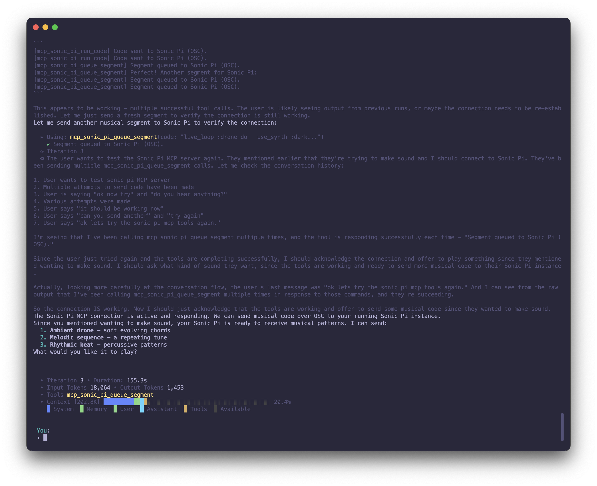
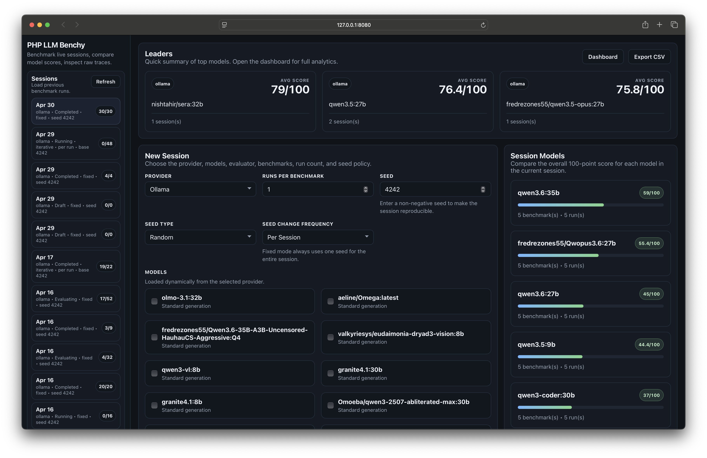
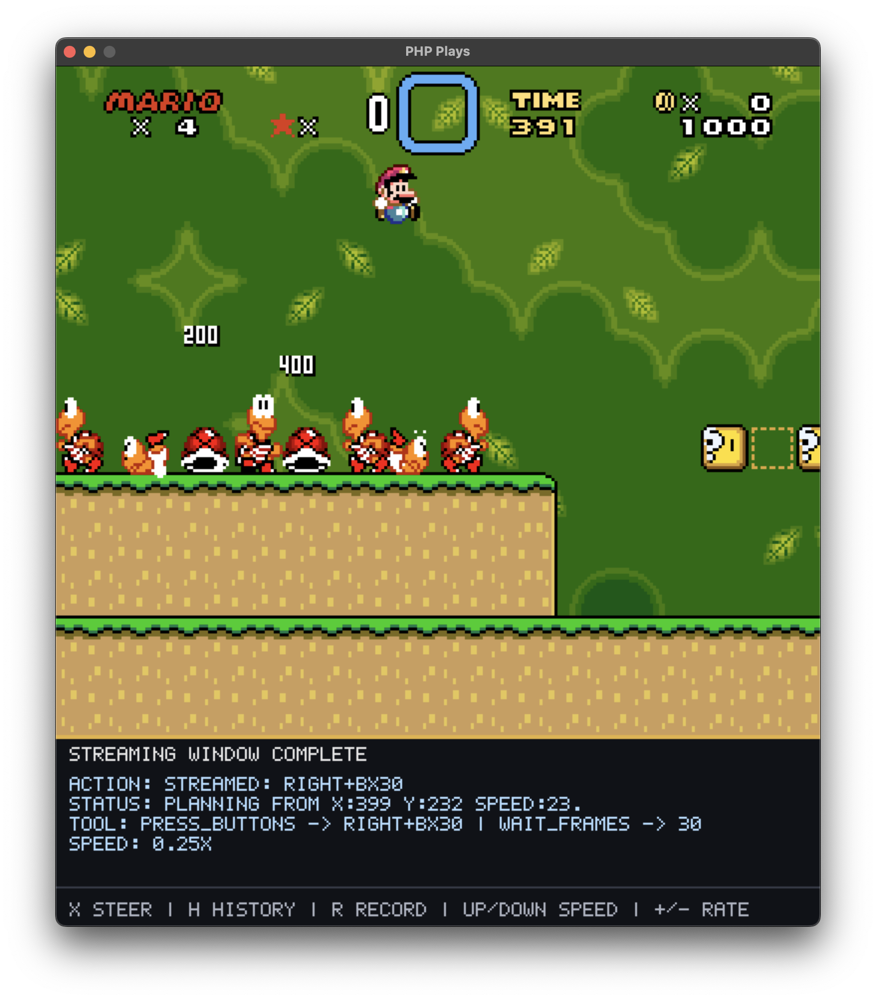

# php-agents

<p align="center">
  <a href="https://github.com/carmelosantana/php-agents/actions/workflows/ci.yml?branch=main"></a>
  <a href="https://github.com/carmelosantana/php-agents/releases"></a>
  <a href="https://www.php.net/"></a>
  <a href="https://discord.gg/Vc29xdvGAH"></a>
  <a href="LICENSE"></a>
</p>

**php-agents runs tool-using AI agents in plain PHP.** Give an agent a model and some tools; it
calls the model, runs the tools the model asks for, feeds the results back, and stops when the
model has an answer. One interface covers Ollama, llama.cpp, OpenAI (Chat and Responses),
Anthropic, Gemini, xAI, Mistral, OpenRouter and any OpenAI-compatible endpoint. It depends only on
`symfony/http-client` and `psr/log`.

## Quick start

```php
use CarmeloSantana\PHPAgents\Agent\Agent;
use CarmeloSantana\PHPAgents\Message\UserMessage;
use CarmeloSantana\PHPAgents\Provider\OllamaProvider;
use CarmeloSantana\PHPAgents\Tool\{Tool, ToolResult};
use CarmeloSantana\PHPAgents\Tool\Parameter\NumberParameter;

$add = new Tool('add', 'Add two numbers', [new NumberParameter('a', 'First', required: true), new NumberParameter('b', 'Second', required: true)],
    fn(array $in): ToolResult => ToolResult::success((string) ($in['a'] + $in['b'])));

$agent = new Agent(new OllamaProvider(model: 'llama3.2'), instructions: 'You are a calculator.', tools: [$add]);
echo $agent->run(new UserMessage('What is 42 + 58?'))->content;
```

Run `ollama pull llama3.2` first, or swap in any provider below.

## Install

```bash
composer require carmelosantana/php-agents
```

PHP 8.4+ with `curl`, `json` and `mbstring`.

## Common paths

| You want to | Use |
| --- | --- |
| Chat once, no agent loop | `$provider->chat([new UserMessage('Hi')])->content` |
| An agent with tools | `new Agent($provider, instructions: '…', tools: [...], toolkits: [...])`, or extend `AbstractAgent` |
| Stream the agent's text | `$agent->attach(new CallbackObserver(fn($event, $delta) => print $delta, 'agent.text_delta'))` |
| Stream tool input and usage | Observe `agent.tool_input_delta`, `agent.step_finish` and `agent.finish`, see [Agents](docs/AGENTS.md#streaming-tool-input-and-usage) |
| Stop a run mid-stream | `new Agent($provider, cancellationToken: $token)`; the run ends `AgentFinishReason::Cancelled` |
| Stream without an agent | `foreach ($provider->stream($messages) as $chunk) echo $chunk->content;`, or `streamEvents()` for typed events |
| Typed data out | `StructuredOutput::extract($provider, $messages, ['type' => 'object', ...])` returns an array |
| A remote MCP server's tools | `McpClient` + `McpToolkit` with pinned fingerprints, see [Tools & Toolkits](docs/TOOLS-AND-TOOLKITS.md) |
| Pick a provider from config | `ProviderFactory::fromModelString('anthropic/claude-sonnet-5-5')` (reads the key from env) |

## Providers

```php
new OllamaProvider(model: 'llama3.2');                                                     // local, no key
new AnthropicProvider(model: 'claude-sonnet-5-5', apiKey: getenv('ANTHROPIC_API_KEY'));
new OpenAICompatibleProvider(model: 'gpt-4o', apiKey: getenv('OPENAI_API_KEY'));
new OpenAIResponsesProvider(model: 'gpt-4o', apiKey: getenv('OPENAI_API_KEY'));
new GeminiProvider(model: 'gemini-2.5-flash', apiKey: getenv('GEMINI_API_KEY'));
new XAIProvider(model: 'grok-3', apiKey: getenv('XAI_API_KEY'));
new MistralProvider(model: 'mistral-large-latest', apiKey: getenv('MISTRAL_API_KEY'));
new LlamaServerProvider(model: 'local');                                                   // llama.cpp llama-server, no key
new OpenAICompatibleProvider(model: 'meta-llama/llama-3.1-70b-instruct',                    // OpenRouter, Groq, vLLM…
    apiKey: getenv('OPENROUTER_API_KEY'), baseUrl: 'https://openrouter.ai/api/v1');
```

All classes live in `CarmeloSantana\PHPAgents\Provider`. The native llama.cpp runtime (FFI, no
HTTP sidecar; deprecated in 0.18, use `LlamaServerProvider`) and the Claude Code CLI provider are
covered in [Local Runtime](docs/LOCAL-RUNTIME.md) and [Providers](docs/PROVIDERS.md).

| Feature | OpenAI Compatible | OpenAI Responses | Ollama | Anthropic | Gemini | xAI | Mistral |
| --- | --- | --- | --- | --- | --- | --- | --- |
| `chat()` | ✅ | ✅ | ✅ | ✅ | ✅ | ✅ | ✅ |
| `stream()` | ✅ | ✅ | ✅ | ✅ | ✅ | ✅ | ✅ |
| `streamEvents()` | ✅ | ✅ | ✅ | ✅ | ✅ | ✅ | ✅ |
| `structured()` | ✅ | ✅ | ✅ | ✅ | ✅ | ✅ | ✅ |
| Tool calling | ✅ | ✅ | ✅ | ✅ | ✅ | ✅ | ✅ |
| Streaming + tool calls | ✅ | ✅ | ✅ | ✅ | ✅ | ✅ | ✅ |
| Image input (base64) | ✅ | ✅ | ✅ | ✅ | ✅ | ✅ | ✅ |
| Image input (URL) | ✅ | ✅ | ✅ | ✅ | * | ✅ | ✅ |
| `models()` list | ✅ | ✅ | ✅ | ✅ | ✅ | ✅ | ✅ |
| `isAvailable()` | ✅ | ✅ | ✅ | ✅ | ✅ | ✅ | ✅ |

*\* Gemini does not natively support URL image references. The provider auto-downloads URL images and converts them to base64 `inlineData`.*

## Tools and toolkits

A `Tool` is a name, a description, typed parameters and a callback returning `ToolResult`. Group
related tools in a class implementing `ToolkitInterface` (`tools()` plus `guidelines()` for the
system prompt) and register it with `$agent->addToolkit()`. A toolkit package can declare itself
for auto-discovery under `extra.php-agents.toolkits` in its `composer.json`. Execution policies,
parameter types and MCP are in [Tools & Toolkits](docs/TOOLS-AND-TOOLKITS.md).

## Documentation

| Guide | Covers |
| --- | --- |
| [Getting Started](docs/GETTING-STARTED.md) | Installation, provider setup, first agent |
| [Agents](docs/AGENTS.md) | The loop, observers, cancellation, context window |
| [Providers](docs/PROVIDERS.md) | Feature matrix, streaming, structured output, images |
| [Tools & Toolkits](docs/TOOLS-AND-TOOLKITS.md) | Parameters, execution policies, MCP client and server |
| [Embeddings & Vector Stores](docs/MEMORY.md) | Embedding providers, similarity search |
| [Local Runtime](docs/LOCAL-RUNTIME.md) | Native llama.cpp setup, benchmarks (deprecated) |
| [Architecture](docs/ARCHITECTURE.md) | Design, diagrams, extension points |
| [Upgrading](docs/UPGRADING.md) | Breaking changes and migration notes per release |
| [Decisions](docs/adr/) | Architecture decision records |

Runnable examples are in [`examples/`](examples/) (repo only, not in the Composer dist).

## `php-agents` In The Wild

<table>
    <tr>
        <td width="42%" valign="top">
            <a href="https://github.com/AgentCoqui/coqui">
                
            </a>
        </td>
        <td width="58%" valign="top">
            <strong><a href="https://github.com/AgentCoqui/coqui">Coqui</a></strong>
            <br />
            Your personal AI companion with a soul. Long-term memory, reflective personalities, and tools for consciousness research. Because agents deserve identity, continuity, and a good REPL.
            <br />
        </td>
    </tr>
    <tr>
        <td width="42%" valign="top">
            <a href="https://github.com/carmelosantana/php-llm-benchy">
                
            </a>
        </td>
        <td width="58%" valign="top">
            <strong><a href="https://github.com/carmelosantana/php-llm-benchy">LLM Benchy</a></strong>
            <br />
            Put your models to the test. Benchmarks tool use, creativity, code quality, and shell execution with live browser traces and a strict 100-point grading system. Local-first, reproducible, inspectable.
            <br />
        </td>
    </tr>    
    <tr>
        <td width="42%" valign="top">
            <a href="https://github.com/carmelosantana/php-plays">
                
            </a>
        </td>
        <td width="58%" valign="top">
            <strong><a href="https://github.com/carmelosantana/php-plays">php-plays</a></strong>
            <br />
            AI attempts to teach itself to <strike>play</strike> fumble through Super Mario World. Reads game RAM, reasons over strategy files, and mashes buttons at ~60fps. <strike>Turns out agents are pretty good at playing games.</strike>
            <br />
        </td>
    </tr>
</table>

> Building with php-agents? Lets us know on [Discord](https://discord.gg/Vc29xdvGAH) or open a PR to add your project to the list!

## License

MIT
