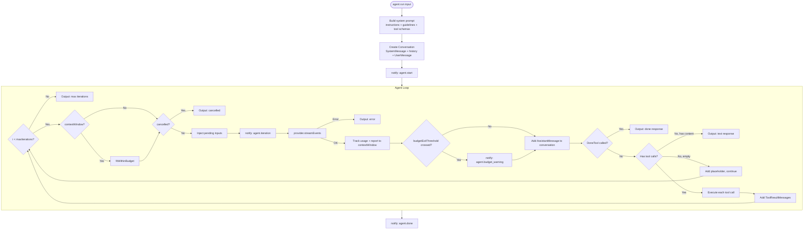

# Agents

Agents are the core abstraction — they combine a provider, tools, and policies into an iterative loop that can reason and act.

## AbstractAgent

All agents extend `AbstractAgent`, which provides the complete agent loop. Your subclass only needs to define:

1. `name()` — the agent's identity
2. `instructions()` — the system prompt
3. Tools (via toolkits or `addTool()`)

```php
<?php

declare(strict_types=1);

namespace Acme;

use CarmeloSantana\PHPAgents\Agent\AbstractAgent;

final class ResearchAgent extends AbstractAgent
{
    public function name(): string
    {
        return 'Research Assistant';
    }

    public function instructions(): string
    {
        return <<<INSTRUCTIONS
        You are a research assistant. Your job is to:
        1. Search the web for information on the user's topic
        2. Read relevant pages
        3. Synthesize findings into a clear summary
        Always cite your sources.
        INSTRUCTIONS;
    }
}
```

## Constructor Parameters

```php
$agent = new ResearchAgent(
    provider: $provider,                    // Required: ProviderInterface
    maxIter: 25,                            // Max tool-use loops (default: 25)
    executionPolicy: new MyPolicy(),        // Optional: tool gating
    cancellationToken: $token,              // Optional: cooperative cancellation
    pendingInputProvider: $inputProvider,   // Optional: external input injection
    contextWindow: new ContextWindow(...),  // Optional: token budget tracking
    safetyMarginPercent: 20,                // Optional: pruning safety margin
    budgetExitThreshold: 0.85,              // Optional: graceful wrap-up threshold
    budgetExitWrapUpIterations: 2,          // Optional: extra iterations after warning
    providerOptions: ['max_tokens' => 8192], // Optional: provider-specific request options
    runLimits: new RunLimits(maxToolCallsPerRun: 50), // Optional: tool-call caps per turn and per run
);
```

| Parameter | Type | Default | Purpose |
|-----------|------|---------|---------|
| `provider` | `ProviderInterface` | — | LLM to use for reasoning |
| `maxIter` | `int` | `25` | Safety limit on tool-use loops |
| `executionPolicy` | `?ToolExecutionPolicyInterface` | `null` | Pre-execution tool gating |
| `cancellationToken` | `?CancellationTokenInterface` | `null` | Cooperative cancellation |
| `pendingInputProvider` | `?PendingInputProviderInterface` | `null` | Inject messages mid-loop |
| `contextWindow` | `?ContextWindowInterface` | `null` | Token budget tracking + auto-pruning |
| `safetyMarginPercent` | `int` | `20` | Headroom applied before pruning to absorb token-estimation drift |
| `budgetExitThreshold` | `float` | `0.0` | Optional ratio `0.0`-`1.0`; emits `agent.budget_warning` once when the current iteration crosses the threshold |
| `budgetExitWrapUpIterations` | `int` | `2` | Extra iterations allowed after a budget warning before the loop returns `BudgetExhausted` |
| `providerOptions` | `array` | `[]` | Provider-specific request options passed to `streamEvents()` on every iteration |
| `runLimits` | `?RunLimits` | `null` | Tool-call caps per turn and per run, which tools may execute, and cumulative wall-time, response-size, token and input-size limits; `null` means `new RunLimits()` (see [Run Limits](#run-limits)) |

`providerOptions` are specific to the provider you pass in: use the keys that provider's API takes
(for example `max_tokens` or `thinking` for Anthropic). The agent sends the same options with every
iteration of the loop, not only the first. They add to the request; they cannot replace the transport
or history fields the provider builds itself (such as `stream`, `messages`, `input` or `contents`).
They cannot replace the agent's instructions or its tools either: the system prompt (`system`,
`systemInstruction`) and the `tools` list come from the agent. See
[Caller Options](PROVIDERS.md#caller-options) for each provider's fields.

Treat `providerOptions` as trusted developer configuration. Never build them from end-user input or
tool output: they can still change the model, the output-token limit and other request settings.

### The ready-made `Agent`

`Agent` is an `AbstractAgent` you configure in the constructor instead of writing a subclass. It
takes the instructions, tools and toolkits directly, and passes run limits, a cancellation token
and provider options through to `AbstractAgent`:

```php
use CarmeloSantana\PHPAgents\Agent\Agent;
use CarmeloSantana\PHPAgents\Agent\RunLimits;

$agent = new Agent(
    $provider,
    instructions: 'You are a calculator.',
    tools: [$add],
    runLimits: new RunLimits(maxRunSeconds: 5),
    cancellationToken: $token,
    providerOptions: ['max_tokens' => 10],
);
```

| Parameter | Type | Default |
|-----------|------|---------|
| `provider` | `ProviderInterface` | — |
| `instructions` | `string` | `'You are a helpful assistant.'` |
| `tools` | `ToolInterface[]` | `[]` |
| `toolkits` | `ToolkitInterface[]` | `[]` |
| `maxIterations` | `int` | `25` (passed on as `maxIter`) |
| `executionPolicy` | `?ToolExecutionPolicyInterface` | `null` |
| `runLimits` | `?RunLimits` | `null` |
| `cancellationToken` | `?CancellationTokenInterface` | `null` |
| `providerOptions` | `array` | `[]` |

Extend `AbstractAgent` for anything else, such as a context window or a pending-input provider.

## Run Limits

`RunLimits` (`src/Agent/RunLimits.php`) bounds what one `run()` may do with tools, and how much
time, response data and tokens it may use whatever the provider reports:

| Field | Default | Effect |
|-------|---------|--------|
| `maxToolCallsPerTurn` | `0` | Tool calls kept from one provider response, counted as they stream (denied and unknown calls included); `0` means no cap |
| `maxToolCallsPerRun` | `0` | Tool calls sent to the policy and executor across the run; `0` means no cap |
| `executeUnadvertisedTools` | `false` | `true` lets the model execute any registered tool, even one `maxTools` left out |
| `maxRunSeconds` | `0.0` | Wall time of the run in seconds, from the start of `run()`; `0.0` means no limit |
| `maxResponseBytes` | `0` | Bytes received from the provider across the run; `0` means no limit |
| `maxEstimatedTokens` | `0` | Local token estimate across the run; `0` means no limit |
| `maxInputTokens` | `0` | Estimated tokens of the new input message; `0` means no limit |

A negative value throws `\InvalidArgumentException`. The first `done` call of a response counts toward neither tool-call cap; a later `done` call in the same response counts toward the per-turn cap.

- **Executable tools.** The agent executes only the tools it advertised to the provider in this run
  (`setMaxTools()` caps that list, and `done` is always in it). A call to any other name is answered
  with the same error as a name that does not exist, `Unknown tool: <name>`, after the execution
  policy has seen it. `executeUnadvertisedTools: true` restores the older behaviour, where every
  registered tool can run.
- **Granted tools.** A host tool that discovers tools (a tool search, for example) implements
  `ToolGrantInterface`. After a call to it runs and returns a successful result, the agent adds every
  name from `grantedToolNames()` that is a registered tool to the executable set for the rest of
  that run. `grantedToolNames()` should return the names granted by the tool's most recent call. Unknown names are ignored, a call the policy denied or a cap refused grants nothing, and
  the next `run()` starts without the grants. Implement it only on trusted host code.
- **Per turn.** The cap is applied while the response streams. A call that opens past
  `maxToolCallsPerTurn` is discarded at once with `agent.tool_input_discarded` reason
  `tool_call_limit`, and its arguments are never kept: it is not shown to the policy, not run, and
  not added to the conversation, so it has no tool result. Its `tool_use` block is also removed from
  the provider content blocks the `AssistantMessage` keeps (matched by position, so a kept call
  that shares its id keeps its own block), and `AnthropicProvider` drops any
  `tool_use` block without a matching call when it replays a conversation. After the response's tool results, `agent.warning` fires once with
  `Tool call limit reached: at most N calls per turn.`
- **Per run.** Calls beyond `maxToolCallsPerRun` get `Tool call limit reached: at most N calls per run.`
  After that round the run ends with `AgentFinishReason::BudgetExhausted` and the content
  `Tool call limit reached for this run.`

```php
use CarmeloSantana\PHPAgents\Agent\RunLimits;

$agent = new ResearchAgent(
    provider: $provider,
    runLimits: new RunLimits(maxToolCallsPerTurn: 8, maxToolCallsPerRun: 50),
);
$agent->setMaxTools(20);
```

### Cumulative limits

The provider, or a proxy in front of it, controls the usage it reports, how much it streams and how
long it takes. These four limits do not depend on any of that. Each one ends the run with
`AgentFinishReason::BudgetExhausted`, emits `agent.error` with the same text as the content, and
returns that fixed content:

| Limit | Checked | Content |
|-------|---------|---------|
| `maxRunSeconds` | At the top of each iteration, on every stream event (idle ticks included), before each serial tool call and before a batch call | `Run time limit reached.` |
| `maxResponseBytes` | On every stream event; the stream is abandoned | `Response size limit reached.` |
| `maxEstimatedTokens` | Before each provider call, on every stream event and after each response | `Token limit reached.` |
| `maxInputTokens` | Before the first provider call, and on each pending input before it is added | `Input is too large.` |

- **Response bytes** count every field the agent keeps from the stream: the text of each text,
  reasoning and tool-input delta; each tool call's id and name, and an end's too when they differ
  from its start's (the call keeps its start's id and name); the JSON of a call's final arguments
  beyond the bytes its deltas already brought (so a provider that sends no deltas is still counted,
  and one that does is not counted twice) and of its metadata; and the finish's raw reason, model
  and content-block JSON. The total runs across every provider call of the run.
- **Estimated tokens.** Before each provider call the request estimate is
  `Conversation::estimateTokens()` plus one token per 4 bytes of the tool schemas' JSON. If the
  tokens spent so far plus that estimate exceed the limit, the run ends before the request is sent.
  While the response streams, the bytes received so far count one token per 4 bytes, and the
  stream is abandoned once the total passes the limit. After the response, the run adds
  `max(reported completion tokens, response bytes / 4)`, so a provider that reports zero or no
  usage still counts. A response that crosses the limit
  ends `BudgetExhausted` even when it carried a final answer.
- **Images.** `Conversation::estimateTokens()`, which both token limits use, counts each image part as `Conversation::IMAGE_TOKENS` (1,000)
  rather than one token per 4 bytes of its base64, so a photo does not trip `maxInputTokens`.
- **Input size.** Only new input is measured: the `$input` message and each message a
  `PendingInputProviderInterface` hands in between iterations, with the same 4-characters-per-token
  heuristic; history is covered by `maxEstimatedTokens`. A larger input never reaches the provider.
- **Tools stopped by time.** A tool call that `maxRunSeconds` stops gets the error result
  `Run time limit reached.` with its call id, so every tool call still has a result.

The limits are cooperative: the agent checks them on every stream event, before each tool and
around batch calls. Providers that poll their stream yield an idle `Tick` while the model is silent,
so `maxRunSeconds` holds then too. A provider that yields nothing, not even a tick (see the
cancellation column in [Streaming Events](PROVIDERS.md#streaming-events)), is bounded only by the
provider's `RequestLimits`, and a single slow tool only by the tool itself.
One oversized chunk is a transport concern too: `RequestLimits::$maxResponseBytes` caps the
downloaded body. An endless stream of empty chunks is bounded only by `maxRunSeconds`: it adds no
response bytes and no tokens.

```php
$agent = new ResearchAgent(
    provider: $provider,
    runLimits: new RunLimits(
        maxRunSeconds: 120.0,
        maxResponseBytes: 4_000_000,
        maxEstimatedTokens: 500_000,
        maxInputTokens: 32_000,
    ),
);
```

## The Run Loop in Detail



## Adding Tools and Toolkits

```php
final class MyAgent extends AbstractAgent
{
    public function instructions(): string
    {
        return 'You are a helpful assistant.';
    }

    public function tools(): array
    {
        return [$myTool];
    }
}

// Add a toolkit (registers all its tools + injects guidelines)
$agent->addToolkit(new MyCustomToolkit());
```

Tools returned by `tools()` are merged with toolkit tools. Guidelines from all toolkits are concatenated and appended to the system prompt.

Your application provides toolkits by implementing `ToolkitInterface`; the one implementation that ships with the library is `McpToolkit`, for a remote MCP server (`grep -rn 'implements ToolkitInterface' src/`). See [Tools & Toolkits](tools-and-toolkits.md) for details on creating and publishing toolkits.

## Observer Pattern

Agents implement `SplSubject`. Attach observers for logging, streaming UI, metrics, or any side-effect:

```php
use SplObserver;
use SplSubject;

final class MetricsObserver implements SplObserver
{
    private int $toolCalls = 0;
    private int $iterations = 0;

    public function update(SplSubject $subject): void
    {
        if (!method_exists($subject, 'lastEvent')) {
            return;
        }

        match ($subject->lastEvent()) {
            'agent.iteration' => $this->iterations++,
            'agent.tool_call' => $this->toolCalls++,
            default => null,
        };
    }

    public function summary(): string
    {
        return sprintf('%d iterations, %d tool calls', $this->iterations, $this->toolCalls);
    }
}

$metrics = new MetricsObserver();
$agent->attach($metrics);
$output = $agent->run(new UserMessage('...'));
echo $metrics->summary();
```

### Events Reference

| Event | Data Type | Description |
|-------|-----------|-------------|
| `agent.start` | `MessageInterface` | The input message before first iteration |
| `agent.iteration` | `int` | Iteration number (1-based) |
| `agent.reasoning` | `string` | A reasoning (thinking) fragment as it streams |
| `agent.text_delta` | `string` | A text fragment as it streams |
| `agent.tool_input_start` | `ToolInputStart` | The model opened a tool call: `index` (0-based, in the order calls opened), `id`, `name` |
| `agent.tool_input_delta` | `ToolInputDelta` | A raw fragment of a call's argument JSON: `index`, `id`, `delta` |
| `agent.tool_input_end` | `ToolInputEnd` | A call's arguments are complete and decoded: `index`, `id`, `name`, `arguments`, `metadata`. It runs only if the response ends in `ToolUse` |
| `agent.done_delta` | `DonePreview` | Provisional decoded text of the `done` call's `response` argument: `callId`, `delta` |
| `agent.tool_input_discarded` | `ToolInputDiscarded` | A call that got `agent.tool_input_start` will not run: `index`, `id`, `name`, `reason` |
| `agent.step_finish` | `StepFinish` | A provider response completed: `iteration`, `reason` (`ProviderFinishReason`), `rawReason`, `usage` (`?Usage`), `model` (`rawReason` and `model` redacted and bounded, see [Error text is redacted and bounded](#error-text-is-redacted-and-bounded)) |
| `agent.empty_response` | `array{attempt: int, maxRetries: int, hasReasoning: bool}` | The response had no text and no tool calls |
| `agent.tool_call` | `ToolCall` | Before a tool is executed |
| `agent.batch_start` | `array{count: int, tools: list<string>}` | A batch tool executor is about to run the approved calls |
| `agent.batch_end` | `array{count: int}` | The batch returned |
| `agent.tool_result` | `ToolResult` | Each tool result, error results included |
| `agent.tool_error` | `string` | When a tool throws an exception |
| `agent.budget_warning` | `array{usagePercent: float, threshold: float, wrapUpIterations: int}` | Budget threshold was crossed for the current iteration |
| `agent.warning` | `string` | Non-fatal notice, such as a tool-call limit reached |
| `agent.error` | `string` | Unrecoverable error in agent loop |
| `agent.done` | `array` | The run produced its answer: the `done` call's arguments, or `['response' => $text]` |
| `agent.finish` | `RunFinish` | Exactly once, last, on every exit path: `reason` (`AgentFinishReason`), `usage` (summed), `iterations`, `model` (redacted and bounded) |

`ToolInputStart`, `ToolInputDelta` and `ToolInputEnd` are the provider's stream events
(`CarmeloSantana\PHPAgents\Provider\Stream`); `DonePreview`, `ToolInputDiscarded`, `StepFinish`
and `RunFinish` live in `CarmeloSantana\PHPAgents\Agent\Event`. An observer that does not know an
event ignores it, so the `default` arm of a `match` keeps working as events are added.

### Streaming tool input and usage

A UI can fill in a tool card while the model is still writing its arguments, and update a usage
gauge after every provider response:

```php
use CarmeloSantana\PHPAgents\Agent\CallbackObserver;
use CarmeloSantana\PHPAgents\Agent\Event\StepFinish;
use CarmeloSantana\PHPAgents\Provider\Stream\ToolInputDelta;

$agent->attach(new CallbackObserver(
    function (string $event, mixed $data): void {
        if ($data instanceof ToolInputDelta) {
            echo $data->delta; // raw argument JSON, as the model writes it
        } elseif ($data instanceof StepFinish) {
            printf("\n[step %d: %s, %d tokens]\n", $data->iteration, $data->reason->value, $data->usage->totalTokens ?? 0);
        }
    },
    'agent.tool_input_delta',
    'agent.step_finish',
));
```

The argument JSON is provisional until `agent.tool_input_end`, and a call runs only when its
response ends in `ToolUse`. A call that will not run gets `agent.tool_input_discarded`, so the UI can
retract its card. Providers that deliver a call whole (Gemini, Ollama, llama.cpp) send one delta
holding the full JSON.

`agent.done_delta` streams a `done` answer the same way: the decoded text of the first `done` call's
`response` argument, as it arrives. `agent.done` accepts it and carries the authoritative
`response`, which a UI renders in place of the preview; `agent.tool_input_discarded` for the same
call id retracts it.

| Discard reason | The call will not run because |
|---|---|
| `not_tool_use` | The response finished with a reason other than `ToolUse` (max tokens, refusal), or with `Error` after the call's arguments completed |
| `invalid_arguments` | The response finished with `Error` and the call's arguments never completed as a JSON object |
| `run_limit` | A `RunLimits` limit (bytes, time, tokens) ended the run first |
| `provider_error` | The stream threw, or ended without a finish, after the call started |
| `cancelled` | A cancel abandoned the response before it finished |
| `done_finished_run` | A `done` call earlier in the same response finished the run |
| `denied` | The execution policy denied the response's first `done` call; the run continues |
| `invalid_done` | The first `done` call's arguments failed validation; the run continues |
| `duplicate_done` | A `done` call that was not the first in its response |
| `tool_call_limit` | The call opened past `RunLimits::$maxToolCallsPerTurn`; it fires right after its `agent.tool_input_start` (or, for a call whose end came without a start, in place of its `agent.tool_input_end`, with no start event), and the call's later input events are not forwarded |

### How a run ends

Every run that returns ends with the same tail: `agent.step_finish` when a provider response
completed, then the `agent.done`, `agent.error` or `agent.warning` this exit emits (some emit none,
the reasoning fallback emits a warning before `done`), then `agent.finish`. Discards for calls that
will not run fire before `agent.step_finish` when the finish reason rules them out, and after it
when the run ends for another reason.

| Exit | Events, in order | `AgentFinishReason` |
|---|---|---|
| Text answer | `step_finish` → `done` → `finish` | `Stop` |
| Reasoning-only answer (fallback) | `step_finish` → `empty_response` → `warning` → `done` → `finish` | `Stop` |
| `done` tool | `step_finish` → `tool_input_discarded` (the response's other calls) → `done` → `finish` | `Done` |
| Tool-call limit per run | `step_finish` → … tools … → `warning` → `finish` | `BudgetExhausted` |
| Budget wrap-up exhausted | `warning` → `finish` | `BudgetExhausted` |
| Run limit while streaming (usage of a finish that already arrived is kept) | `tool_input_discarded` (`run_limit`, each started call) → `error` → `finish` | `BudgetExhausted` |
| Token limit after a response | `step_finish` → `tool_input_discarded` (`run_limit`, each completed call) → `error` → `finish` | `BudgetExhausted` |
| Run limit elsewhere (time, input size) | `error` → `finish` | `BudgetExhausted` |
| Repeated empty responses | `step_finish` → `empty_response` → `error` → `finish` | `EmptyResponse` |
| Max iterations | `error` → `finish` | `MaxIterations` |
| Refusal, content filter, context window | `step_finish` → `finish` | `Refusal`, `ContentFilter`, `ContextWindowExceeded` |
| Provider error finish (`Error`, `PauseTurn`, `MaxTokens` with no text) | `step_finish` → `error` → `finish` | `Error` |
| Stream ended without a finish | `tool_input_discarded` (`provider_error`) → `error` → `finish` | `Error` |
| Provider exception (token not set) | `tool_input_discarded` (`provider_error`) → `error` → `finish` | `Error` |
| Tool `TerminationException` | `step_finish` → … tools … → `finish` (no `agent.error`) | `Error` |
| Cancel mid-stream (or a provider exception once the token is set) | `tool_input_discarded` (`cancelled`, each started call) → `error` `'Task cancelled'` → `finish` | `Cancelled` |
| Cancel after a text or `done` answer finished, before it is accepted (refusal, filter, context-window and error finishes keep their reason) | `step_finish` → `tool_input_discarded` (`cancelled`, each call of a `done` response) → `error` `'Task cancelled'` → `finish` | `Cancelled` |
| Cancel after an empty response, landing anywhere from `step_finish` to `empty_response` (`budget_warning` included), before the empty-response policy retries, falls back to reasoning or gives up | `step_finish` → (`budget_warning`) → `empty_response` → `error` `'Task cancelled'` → `finish` | `Cancelled` |
| Cancel at the top of an iteration or during tools | `error` `'Task cancelled'` → `finish` | `Cancelled` |

Rows that start with `error` follow whatever the step already fired: a cancel or time limit during
tools comes after that response's `step_finish` and tool events. An exception that escapes `run()`
(thrown by an observer, for example) skips `agent.finish`.

### Error text is redacted and bounded

Error text from providers and tools is untrusted: it can carry a credential or terminal control bytes. Before it reaches `Output`, an event, the conversation or the model, the agent passes it through `CarmeloSantana\PHPAgents\Security\UntrustedText::forDisplay()`, which replaces credential-shaped strings with `[redacted]` (Bearer and Basic credentials, `sk-`, `AIza`, `xai-`, GitHub and AWS key shapes, and the value after keys such as `api_key=`, `Authorization:`, `token`, `secret` or `password`, a quoted value whole, escapes included, or to the end of the text when it is never closed; the Bearer and Basic scheme words match in any case; a key shape is caught after `_` or punctuation but not after a letter or digit, so `reason_sk-…` is redacted and `task-…` is not), turns control and format characters (and the invisible Hangul fillers) into spaces, collapses and trims whitespace and cuts the text with `…`, so a limit of N characters gives at most N + 1. A credential split by a control or format character (`sk-AAAA<U+200B>BBBB…`, `Bearer<ESC>abc…`) is still redacted; when the split is inside the credential, the invisible characters in that text are removed instead of becoming spaces.

- A provider failure: `Output::$content` is `Provider error: ` plus the exception message cut to 300 characters, and `agent.error` carries the same text without the prefix. For a 4xx, at most the first 64 KiB of the body are read, and only a string `error.message` or `message` from a JSON body is appended as `\n\nAPI response: …`, also cut to 300. A body without one, or one that is not JSON, is never echoed.
- A tool failure: every error or timeout `ToolResult` (a thrown exception, a returned error, a policy denial, an unknown tool, a batch executor's error or timeout) is cut to 500 characters, and so is every string in its metadata, keys included (an object in the metadata is first turned into arrays through JSON), with its `errorCode` cut to 64 characters, in `Output::$toolResults`, the conversation, `agent.tool_result` and `agent.tool_error`. Successful tool content and metadata are the tool's own data and are not rewritten.
- Finish telemetry: the provider's raw finish reason and model id in `agent.step_finish` (`StepFinish::$rawReason`, `$model`) and the model in `agent.finish` (`RunFinish::$model`) are cut to 128 characters (129 with the `…`). The normalised `reason` is not rewritten, and neither are `Output::$model`, `Response::$model` nor the `Finish` a direct `streamEvents()` caller reads: pass those through `UntrustedText::forDisplay()` yourself before logging them.

Redaction is a pattern match. An opaque credential that matches none of these shapes cannot be redacted, so keep secrets out of exception messages your own tools throw.

## Cooperative Cancellation

Long-running agents can be cancelled via `CancellationTokenInterface`:

```php
use CarmeloSantana\PHPAgents\Contract\CancellationTokenInterface;

final class TimeoutToken implements CancellationTokenInterface
{
    private readonly float $deadline;

    public function __construct(int $timeoutSeconds)
    {
        $this->deadline = microtime(true) + $timeoutSeconds;
    }

    public function isCancelled(): bool
    {
        return microtime(true) >= $this->deadline;
    }
}

$agent = new MyAgent(
    provider: $provider,
    cancellationToken: new TimeoutToken(30),
);

// Agent will stop after 30 seconds, even mid-loop
```

The token is checked at the top of each iteration, on every stream event (including the idle `Tick`s, so a silent model can be stopped), after the response finishes (after `agent.step_finish`, after the execution policy allows `done`, after `agent.empty_response`, and just before a text answer is accepted), before each tool call and before a batch starts. Which providers tick during silence, and which only check per chunk, is listed under [Streaming Events](PROVIDERS.md#streaming-events). A cancel ends the run with `AgentFinishReason::Cancelled`, after `agent.error` with `'Task cancelled'`, except one that lands after a refusal, content-filter, context-window or provider-error finish: that run keeps its own finish reason, since it ends anyway and the reason is information the caller needs:

| When | Outcome |
|---|---|
| Top of an iteration | `content` is `'Task was cancelled.'`; the provider is not called |
| Mid-stream | The stream is abandoned (the HTTP response is cancelled). `content` is the text streamed so far in this step, followed by the `done` answer previewed so far (`agent.done_delta`) if one was streaming (a blank line between them when both are present), appended to the conversation as an `AssistantMessage` with no tool calls, or `'Task was cancelled.'` when none arrived. No call of the response runs: each started call gets `agent.tool_input_discarded` with reason `cancelled`. A provider that throws, or whose stream ends without a finish, once the token is set (a cancel that aborts the transport) ends the same way, not as a provider error |
| After the response finished, before its answer is accepted | Only for a response the run would accept as its answer: text (finish `Stop`, `ToolUse` or `MaxTokens`), a `done` call, or an empty response (before the empty-response policy retries, falls back to reasoning, or ends `EmptyResponse`). `content` is as for a mid-stream cancel: the full streamed text, then the `done` answer as its preview streamed (`agent.done_delta`), not the completed call's arguments; `'Task was cancelled.'` when both are empty (reasoning is never the content). Each of the response's calls gets `agent.tool_input_discarded` with reason `cancelled`, and no `agent.done` fires. A response of ordinary tool calls is answered as during tools; refusal, content-filter, context-window and provider-error finishes keep their own reason |
| During tools | Calls that finished keep their results. Every call that did not start gets an error `ToolResult` with content `'Cancelled before it ran.'` and `errorCode` `'cancelled'`, so every call in the conversation has a result and `repairToolPairing()` keeps the group. A running tool or batch is not interrupted; a batch's results are all kept. `content` is `'Task was cancelled.'` |

## Pending Input Injection

Inject messages into the agent loop from external sources (e.g., user typing while the agent is working):

```php
use CarmeloSantana\PHPAgents\Contract\PendingInputProviderInterface;
use CarmeloSantana\PHPAgents\Contract\MessageInterface;

final class QueuedInputProvider implements PendingInputProviderInterface
{
    private array $queue = [];

    public function addInput(MessageInterface $message): void
    {
        $this->queue[] = $message;
    }

    public function consumePendingInputs(): array
    {
        $inputs = $this->queue;
        $this->queue = [];
        return $inputs;
    }
}

$inputProvider = new QueuedInputProvider();
$agent = new MyAgent(
    provider: $provider,
    pendingInputProvider: $inputProvider,
);

// From another thread/fiber:
$inputProvider->addInput(new UserMessage('Actually, also check the tests/ directory'));
```

## Context Window Integration

Prevent conversations from exceeding model token limits:

```php
use CarmeloSantana\PHPAgents\Context\ContextWindow;
$contextWindow = new ContextWindow(
    maxTok: 128_000,   // Model's context limit
    reservedTok: 4_000 // Space reserved for the response
);

$agent = new MyAgent(
    provider: $provider,
    contextWindow: $contextWindow,
);
```

When the conversation approaches the token budget, the agent loop automatically:

1. Trims long tool results
2. Drops oldest conversation turns
3. Re-trims tool results more aggressively if one turn still exceeds budget
4. Repairs orphaned tool-result/assistant-message pairs
5. Merges consecutive same-role messages

If `budgetExitThreshold` is configured and a `ContextWindow` is present, the agent also emits `agent.budget_warning` once when the current iteration's usage crosses the configured threshold. Usage is the higher of the window's `usagePercent()` and the agent's local estimate (request estimate plus response bytes / 4), so a provider or a custom `ContextWindowInterface` that under-reports cannot hide it. Before every provider call the agent passes its request estimate to `estimate()`, and after the response the request-plus-response estimate, then `report()`. `ContextWindow::report()` keeps the higher of the reported total and that estimate. The loop then allows `budgetExitWrapUpIterations` additional iterations before returning `AgentFinishReason::BudgetExhausted`.

## The Output Value Object

`AbstractAgent::run()` returns an `Output` with the agent's response and metadata:

```php
$output = $agent->run(new UserMessage('...'));

$output->content;      // string — the final text response
$output->toolResults;  // ToolResult[] — tool results accumulated across the run
$output->usage;        // Usage — total token usage across all iterations
$output->model;        // string — model name reported by the provider
$output->iterations;   // int — iterations consumed by the loop
$output->conversation; // Conversation|null — full in-memory conversation
$output->finishReason; // AgentFinishReason — why the agent stopped
$output->providerFinishReason; // ProviderFinishReason|null — the provider's stop reason for the last response
```

### Finish Reasons

| Reason | Meaning |
|--------|---------|
| `AgentFinishReason::Stop` | Agent returned a text response without using `done()` |
| `AgentFinishReason::MaxIterations` | Agent loop exhausted its configured `maxIterations` budget |
| `AgentFinishReason::Error` | An error occurred in the agent loop |
| `AgentFinishReason::Done` | Agent completed via the built-in `done()` tool |
| `AgentFinishReason::BudgetExhausted` | Budget wrap-up iterations were exhausted after a budget warning, a `RunLimits` tool-call cap for the run was reached, or a `RunLimits` cumulative limit (time, response bytes, estimated tokens, input size) was reached |
| `AgentFinishReason::EmptyResponse` | The model kept returning empty replies after the configured empty-response retries |
| `AgentFinishReason::Refusal` | The provider refused the request; `content` is the text received |
| `AgentFinishReason::ContentFilter` | The provider's content filter stopped the response; `content` is the text received |
| `AgentFinishReason::ContextWindowExceeded` | The request did not fit the model's context window |
| `AgentFinishReason::Cancelled` | The cancellation token was set; see [Cooperative Cancellation](#cooperative-cancellation) |

Provider responses use `ProviderFinishReason` instead. That enum represents normalized model/API stop reasons: `Stop`, `ToolUse`, `MaxTokens`, `Error`, `Refusal`, `ContentFilter`, `PauseTurn` and `ContextWindowExceeded`. `Output::$providerFinishReason` carries the reason for the last provider response, or `null` on an output not built from a provider response (cancellation, budget exhaustion, max iterations or a thrown provider error).

The agent reads the provider reason before it looks at `done()`, tool calls or text. A failed stop ends the run whatever content or tool calls arrived first: no tool runs and no `agent.done` is emitted.

| Provider reason | Agent outcome |
|---|---|
| `Stop` | Text is returned as `AgentFinishReason::Stop` (empty text goes to the empty-response policy) |
| `ToolUse` | Tool calls run; the only reason that runs them. With no tool calls collected it goes to the empty-response policy |
| `MaxTokens` | Text is returned as `AgentFinishReason::Stop`; any tool calls are dropped |
| `MaxTokens` with no text | `AgentFinishReason::Error` with content `'Provider stopped at max_tokens before producing an answer; raise max_tokens in providerOptions.'` and an `agent.error` event; any tool calls are dropped and the model is not asked again |
| `Refusal` | `AgentFinishReason::Refusal`; the text is added as an assistant turn without tool calls |
| `ContentFilter` | `AgentFinishReason::ContentFilter`, the same way |
| `ContextWindowExceeded` | `AgentFinishReason::ContextWindowExceeded` |
| `Error` | `AgentFinishReason::Error` with content `'Provider error: the response ended without a valid finish reason.'` and an `agent.error` event |
| `PauseTurn` | `AgentFinishReason::Error` with content `'Provider paused the turn (pause_turn); server-tool continuation is not supported.'` and an `agent.error` event |

The turn's reason is the reason on the stream's one `Finish` event, and a stream that ends without one counts as `Error`. A provider built on `StreamsEventsFromResponses` (see [Creating a Custom Provider](PROVIDERS.md#creating-a-custom-provider)) merges its `stream()` chunks into that `Finish`. The first failure reason a chunk carries (`Error`, `Refusal`, `ContentFilter`, `ContextWindowExceeded`, `PauseTurn` or `MaxTokens`) is the turn's reason: no later chunk changes it to `ToolUse` or `Stop`, and every tool call of the turn is dropped. Without a failure the reason is the last chunk reason that is not `Stop`; when every chunk says `Stop` it is `ToolUse` if tool calls were collected, otherwise `Stop`. Usage on a failed finish still counts toward `Output::$usage` and the context window.
