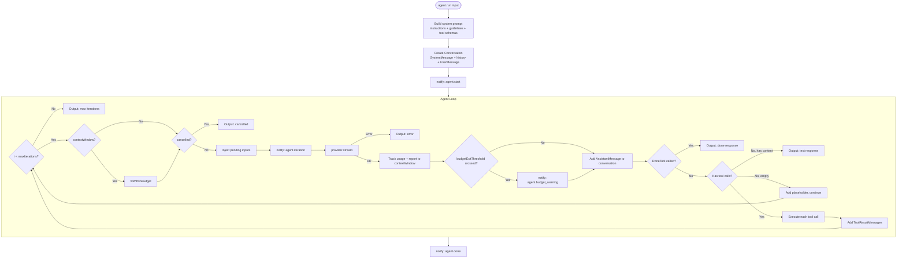

# Agents

Agents are the core abstraction — they combine a provider, tools, and policies into an iterative loop that can reason and act.

## AbstractAgent

All agents extend `AbstractAgent`, which provides the complete agent loop. Your subclass only needs to define:

1. `name()` — the agent's identity
2. `instructions()` — the system prompt
3. Tools (via toolkits or `addTool()`)

```php
<?php

declare(strict_types=1);

namespace Acme;

use CarmeloSantana\PHPAgents\Agent\AbstractAgent;

final class ResearchAgent extends AbstractAgent
{
    public function name(): string
    {
        return 'Research Assistant';
    }

    public function instructions(): string
    {
        return <<<INSTRUCTIONS
        You are a research assistant. Your job is to:
        1. Search the web for information on the user's topic
        2. Read relevant pages
        3. Synthesize findings into a clear summary
        Always cite your sources.
        INSTRUCTIONS;
    }
}
```

## Constructor Parameters

```php
$agent = new ResearchAgent(
    provider: $provider,                    // Required: ProviderInterface
    maxIter: 25,                            // Max tool-use loops (default: 25)
    executionPolicy: new MyPolicy(),        // Optional: tool gating
    cancellationToken: $token,              // Optional: cooperative cancellation
    pendingInputProvider: $inputProvider,   // Optional: external input injection
    contextWindow: new ContextWindow(...),  // Optional: token budget tracking
    safetyMarginPercent: 20,                // Optional: pruning safety margin
    budgetExitThreshold: 0.85,              // Optional: graceful wrap-up threshold
    budgetExitWrapUpIterations: 2,          // Optional: extra iterations after warning
    providerOptions: ['max_tokens' => 8192], // Optional: provider-specific request options
    runLimits: new RunLimits(maxToolCallsPerRun: 50), // Optional: tool-call caps per turn and per run
);
```

| Parameter | Type | Default | Purpose |
|-----------|------|---------|---------|
| `provider` | `ProviderInterface` | — | LLM to use for reasoning |
| `maxIter` | `int` | `25` | Safety limit on tool-use loops |
| `executionPolicy` | `?ToolExecutionPolicyInterface` | `null` | Pre-execution tool gating |
| `cancellationToken` | `?CancellationTokenInterface` | `null` | Cooperative cancellation |
| `pendingInputProvider` | `?PendingInputProviderInterface` | `null` | Inject messages mid-loop |
| `contextWindow` | `?ContextWindowInterface` | `null` | Token budget tracking + auto-pruning |
| `safetyMarginPercent` | `int` | `20` | Headroom applied before pruning to absorb token-estimation drift |
| `budgetExitThreshold` | `float` | `0.0` | Optional ratio `0.0`-`1.0`; emits `agent.budget_warning` once when the current iteration crosses the threshold |
| `budgetExitWrapUpIterations` | `int` | `2` | Extra iterations allowed after a budget warning before the loop returns `BudgetExhausted` |
| `providerOptions` | `array` | `[]` | Provider-specific request options passed to `stream()` on every iteration |
| `runLimits` | `?RunLimits` | `null` | Tool-call caps per turn and per run, and which tools may execute; `null` means `new RunLimits()` (see [Run Limits](#run-limits)) |

`providerOptions` are specific to the provider you pass in: use the keys that provider's API takes
(for example `max_tokens` or `thinking` for Anthropic). The agent sends the same options with every
iteration of the loop, not only the first. They add to the request; they cannot replace the transport
or history fields the provider builds itself (such as `stream`, `messages`, `input` or `contents`).
They cannot replace the agent's instructions or its tools either: the system prompt (`system`,
`systemInstruction`) and the `tools` list come from the agent. See
[Caller Options](PROVIDERS.md#caller-options) for each provider's fields.

Treat `providerOptions` as trusted developer configuration. Never build them from end-user input or
tool output: they can still change the model, the output-token limit and other request settings.

## Run Limits

`RunLimits` (`src/Agent/RunLimits.php`) bounds what one `run()` may do with tools:

| Field | Default | Effect |
|-------|---------|--------|
| `maxToolCallsPerTurn` | `0` | Tool calls run from one provider response; `0` means no cap |
| `maxToolCallsPerRun` | `0` | Tool calls sent to the policy and executor across the run; `0` means no cap |
| `executeUnadvertisedTools` | `false` | `true` lets the model execute any registered tool, even one `maxTools` left out |

A negative cap throws `\InvalidArgumentException`. The `done` tool counts toward neither cap.

- **Executable tools.** The agent executes only the tools it advertised to the provider in this run
  (`setMaxTools()` caps that list, and `done` is always in it). A call to any other name is answered
  with the same error as a name that does not exist, `Unknown tool: <name>`, after the execution
  policy has seen it. `executeUnadvertisedTools: true` restores the older behaviour, where every
  registered tool can run.
- **Granted tools.** A host tool that discovers tools (a tool search, for example) implements
  `ToolGrantInterface`. After a call to it runs and returns a non-error result, the agent adds every
  name from `grantedToolNames()` that is a registered tool to the executable set for the rest of
  that run. Unknown names are ignored, a call the policy denied or a cap refused grants nothing, and
  the next `run()` starts without the grants. Implement it only on trusted host code.
- **Per turn.** Calls beyond `maxToolCallsPerTurn` in one response are not shown to the policy and
  not run. Each gets the error result `Tool call limit reached: at most N calls per turn.` with its
  call id, so every tool call still has a result, and `agent.warning` fires once for the turn.
- **Per run.** Calls beyond `maxToolCallsPerRun` get `Tool call limit reached: at most N calls per run.`
  After that round the run ends with `AgentFinishReason::BudgetExhausted` and the content
  `Tool call limit reached for this run.`

```php
use CarmeloSantana\PHPAgents\Agent\RunLimits;

$agent = new ResearchAgent(
    provider: $provider,
    runLimits: new RunLimits(maxToolCallsPerTurn: 8, maxToolCallsPerRun: 50),
);
$agent->setMaxTools(20);
```

## The Run Loop in Detail



## Adding Tools and Toolkits

```php
final class MyAgent extends AbstractAgent
{
    public function instructions(): string
    {
        return 'You are a helpful assistant.';
    }

    public function tools(): array
    {
        return [$myTool];
    }
}

// Add a toolkit (registers all its tools + injects guidelines)
$agent->addToolkit(new MyCustomToolkit());
```

Tools returned by `tools()` are merged with toolkit tools. Guidelines from all toolkits are concatenated and appended to the system prompt.

Your application provides toolkits by implementing `ToolkitInterface`; the one implementation that ships with the library is `McpToolkit`, for a remote MCP server (`grep -rn 'implements ToolkitInterface' src/`). See [Tools & Toolkits](tools-and-toolkits.md) for details on creating and publishing toolkits.

## Observer Pattern

Agents implement `SplSubject`. Attach observers for logging, streaming UI, metrics, or any side-effect:

```php
use SplObserver;
use SplSubject;

final class MetricsObserver implements SplObserver
{
    private int $toolCalls = 0;
    private int $iterations = 0;

    public function update(SplSubject $subject): void
    {
        if (!method_exists($subject, 'lastEvent')) {
            return;
        }

        match ($subject->lastEvent()) {
            'agent.iteration' => $this->iterations++,
            'agent.tool_call' => $this->toolCalls++,
            default => null,
        };
    }

    public function summary(): string
    {
        return sprintf('%d iterations, %d tool calls', $this->iterations, $this->toolCalls);
    }
}

$metrics = new MetricsObserver();
$agent->attach($metrics);
$output = $agent->run(new UserMessage('...'));
echo $metrics->summary();
```

### Events Reference

| Event | Data Type | Description |
|-------|-----------|-------------|
| `agent.start` | `MessageInterface` | The input message before first iteration |
| `agent.iteration` | `int` | Iteration number (1-based) |
| `agent.tool_call` | `ToolCall` | Before a tool is executed |
| `agent.tool_result` | `ToolResult` | After successful tool execution |
| `agent.tool_error` | `string` | When a tool throws an exception |
| `agent.done` | `array` | Agent completed (contains response data) |
| `agent.budget_warning` | `array{usagePercent: float, threshold: float, wrapUpIterations: int}` | Budget threshold was crossed for the current iteration |
| `agent.warning` | `string` | Non-fatal notice, such as a tool-call limit reached |
| `agent.error` | `string` | Unrecoverable error in agent loop |

### Error text is redacted and bounded

Error text from providers and tools is untrusted: it can carry a credential or terminal control bytes. Before it reaches `Output`, an event, the conversation or the model, the agent passes it through `CarmeloSantana\PHPAgents\Security\UntrustedText::forDisplay()`, which replaces credential-shaped strings with `[redacted]` (Bearer tokens, `sk-`, `AIza`, `xai-`, GitHub and AWS key shapes, and the value after keys such as `api_key=`, `Authorization:`, `token`, `secret` or `password`), turns control and format characters into spaces, collapses whitespace and cuts the text with `…`.

- A provider failure: `Output::$content` is `Provider error: ` plus the exception message cut to 300 characters, and `agent.error` carries the same text without the prefix. For a 4xx, at most the first 64 KiB of the body are read, and only a string `error.message` or `message` from a JSON body is appended as `\n\nAPI response: …`, also cut to 300. A body without one, or one that is not JSON, is never echoed.
- A tool failure: every error `ToolResult` (a thrown exception, a returned error, a policy denial, an unknown tool, a batch executor's error) is cut to 500 characters, in `Output::$toolResults`, the conversation, `agent.tool_result` and `agent.tool_error`. Successful tool content is the tool's own data and is not rewritten.

Redaction is a pattern match. An opaque credential that matches none of these shapes cannot be redacted, so keep secrets out of exception messages your own tools throw.

## Cooperative Cancellation

Long-running agents can be cancelled via `CancellationTokenInterface`:

```php
use CarmeloSantana\PHPAgents\Contract\CancellationTokenInterface;

final class TimeoutToken implements CancellationTokenInterface
{
    private readonly float $deadline;

    public function __construct(int $timeoutSeconds)
    {
        $this->deadline = microtime(true) + $timeoutSeconds;
    }

    public function isCancelled(): bool
    {
        return microtime(true) >= $this->deadline;
    }
}

$agent = new MyAgent(
    provider: $provider,
    cancellationToken: new TimeoutToken(30),
);

// Agent will stop after 30 seconds, even mid-loop
```

The cancellation check happens at the top of each iteration, so the current iteration always completes before stopping.

## Pending Input Injection

Inject messages into the agent loop from external sources (e.g., user typing while the agent is working):

```php
use CarmeloSantana\PHPAgents\Contract\PendingInputProviderInterface;
use CarmeloSantana\PHPAgents\Contract\MessageInterface;

final class QueuedInputProvider implements PendingInputProviderInterface
{
    private array $queue = [];

    public function addInput(MessageInterface $message): void
    {
        $this->queue[] = $message;
    }

    public function consumePendingInputs(): array
    {
        $inputs = $this->queue;
        $this->queue = [];
        return $inputs;
    }
}

$inputProvider = new QueuedInputProvider();
$agent = new MyAgent(
    provider: $provider,
    pendingInputProvider: $inputProvider,
);

// From another thread/fiber:
$inputProvider->addInput(new UserMessage('Actually, also check the tests/ directory'));
```

## Context Window Integration

Prevent conversations from exceeding model token limits:

```php
use CarmeloSantana\PHPAgents\Context\ContextWindow;
$contextWindow = new ContextWindow(
    maxTok: 128_000,   // Model's context limit
    reservedTok: 4_000 // Space reserved for the response
);

$agent = new MyAgent(
    provider: $provider,
    contextWindow: $contextWindow,
);
```

When the conversation approaches the token budget, the agent loop automatically:

1. Trims long tool results
2. Drops oldest conversation turns
3. Re-trims tool results more aggressively if one turn still exceeds budget
4. Repairs orphaned tool-result/assistant-message pairs
5. Merges consecutive same-role messages

If `budgetExitThreshold` is configured and a `ContextWindow` is present, the agent also emits `agent.budget_warning` once when the latest provider-reported usage for the current iteration crosses the configured threshold. The loop then allows `budgetExitWrapUpIterations` additional iterations before returning `AgentFinishReason::BudgetExhausted`.

## The Output Value Object

`AbstractAgent::run()` returns an `Output` with the agent's response and metadata:

```php
$output = $agent->run(new UserMessage('...'));

$output->content;      // string — the final text response
$output->toolResults;  // ToolResult[] — tool results accumulated across the run
$output->usage;        // Usage — total token usage across all iterations
$output->model;        // string — model name reported by the provider
$output->iterations;   // int — iterations consumed by the loop
$output->conversation; // Conversation|null — full in-memory conversation
$output->finishReason; // AgentFinishReason — why the agent stopped
$output->providerFinishReason; // ProviderFinishReason|null — the provider's stop reason for the last response
```

### Finish Reasons

| Reason | Meaning |
|--------|---------|
| `AgentFinishReason::Stop` | Agent returned a text response without using `done()` |
| `AgentFinishReason::MaxIterations` | Agent loop exhausted its configured `maxIterations` budget |
| `AgentFinishReason::Error` | An error occurred in the agent loop |
| `AgentFinishReason::Done` | Agent completed via the built-in `done()` tool |
| `AgentFinishReason::BudgetExhausted` | Budget wrap-up iterations were exhausted after a budget warning, or a `RunLimits` tool-call cap for the run was reached |
| `AgentFinishReason::EmptyResponse` | The model kept returning empty replies after the configured empty-response retries |
| `AgentFinishReason::Refusal` | The provider refused the request; `content` is the text received |
| `AgentFinishReason::ContentFilter` | The provider's content filter stopped the response; `content` is the text received |
| `AgentFinishReason::ContextWindowExceeded` | The request did not fit the model's context window |

Provider responses use `ProviderFinishReason` instead. That enum represents normalized model/API stop reasons: `Stop`, `ToolUse`, `MaxTokens`, `Error`, `Refusal`, `ContentFilter`, `PauseTurn` and `ContextWindowExceeded`. `Output::$providerFinishReason` carries the reason for the last provider response, or `null` on an output not built from a provider response (cancellation, budget exhaustion, max iterations or a thrown provider error).

The agent reads the provider reason before it looks at `done()`, tool calls or text. A failed stop ends the run whatever content or tool calls arrived first: no tool runs and no `agent.done` is emitted.

| Provider reason | Agent outcome |
|---|---|
| `Stop` | Text is returned as `AgentFinishReason::Stop` (empty text goes to the empty-response policy) |
| `ToolUse` | Tool calls run; the only reason that runs them. With no tool calls collected it goes to the empty-response policy |
| `MaxTokens` | Text is returned as `AgentFinishReason::Stop`; any tool calls are dropped |
| `MaxTokens` with no text | `AgentFinishReason::Error` with content `'Provider stopped at max_tokens before producing an answer; raise max_tokens in providerOptions.'` and an `agent.error` event; any tool calls are dropped and the model is not asked again |
| `Refusal` | `AgentFinishReason::Refusal`; the text is added as an assistant turn without tool calls |
| `ContentFilter` | `AgentFinishReason::ContentFilter`, the same way |
| `ContextWindowExceeded` | `AgentFinishReason::ContextWindowExceeded` |
| `Error` | `AgentFinishReason::Error` with content `'Provider error: the response ended without a valid finish reason.'` and an `agent.error` event |
| `PauseTurn` | `AgentFinishReason::Error` with content `'Provider paused the turn (pause_turn); server-tool continuation is not supported.'` and an `agent.error` event |

The first failure reason a chunk carries (`Error`, `Refusal`, `ContentFilter`, `ContextWindowExceeded`, `PauseTurn` or `MaxTokens`) is the turn's reason: no later chunk changes it to `ToolUse` or `Stop`, and every tool call of the turn is dropped. Without a failure the reason is the last chunk reason that is not `Stop`; when every chunk says `Stop` it is `ToolUse` if tool calls were collected, otherwise `Stop`. Usage on a failed chunk still counts toward `Output::$usage` and the context window.
