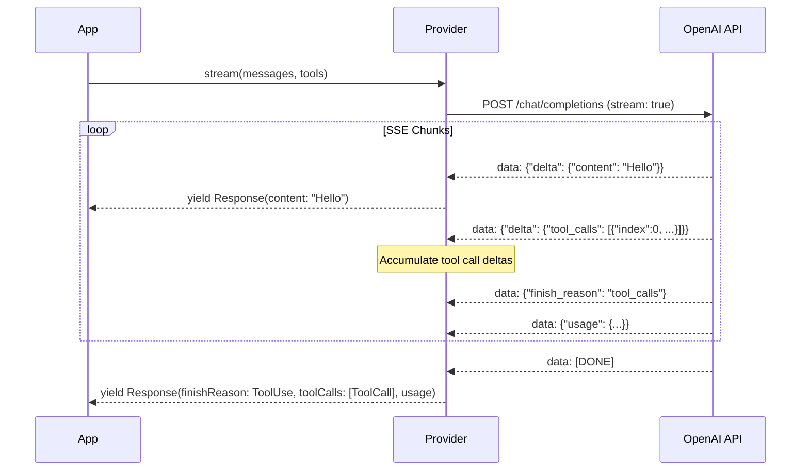
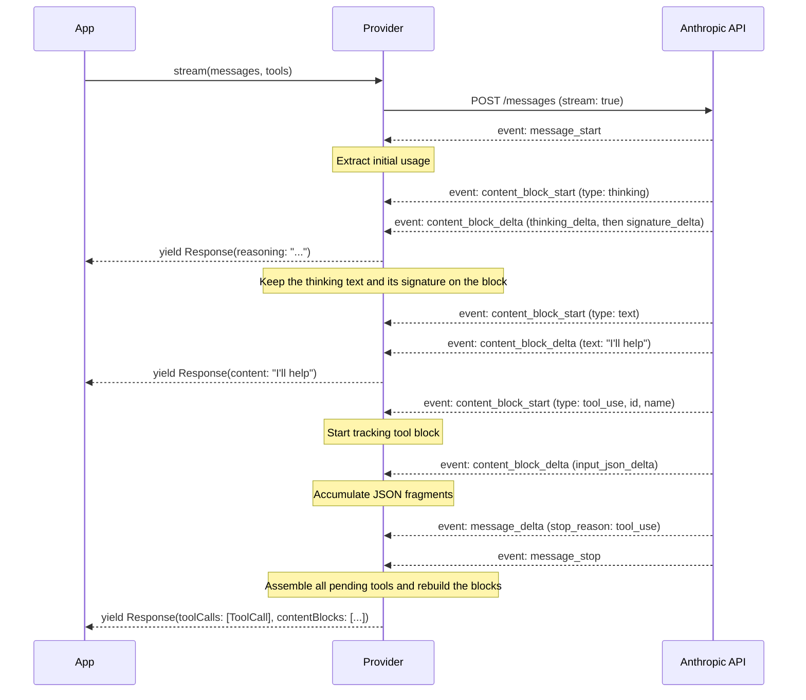

# Providers

Providers abstract the differences between LLM APIs. php-agents ships with providers covering the major ecosystems.

## Provider Feature Matrix

| Feature | OpenAI Compatible | OpenAI Responses | Ollama | Anthropic | Gemini | xAI | Mistral | LlamaCpp (deprecated) |
|---------|:-:|:-:|:-:|:-:|:-:|:-:|:-:|:-:|
| `chat()` | ✅ | ✅ | ✅ | ✅ | ✅ | ✅ | ✅ | ✅ |
| `stream()` | ✅ | ✅ | ✅ | ✅ | ✅ | ✅ | ✅ | ✅ |
| `streamEvents()` | ✅ | ✅ | ✅ | ✅ | ✅ | ✅ | ✅ | ✅ |
| `structured()` | ✅ | ✅ | ✅ | ✅ | ✅ | ✅ | ✅ | ✅ |
| Tool calling | ✅ | ✅ | ✅ | ✅ | ✅ | ✅ | ✅ | ✅ |
| Streaming + tool calls | ✅ | ✅ | ✅ | ✅ | ✅ | ✅ | ✅ | ✅ |
| Image input (base64) | ✅ | ✅ | ✅ | ✅ | ✅ | ✅ | ✅ | ✅ |
| Image input (URL) | ✅ | ✅ | ✅ | ✅ | ✅* | ✅ | ✅ | ✅ |
| `models()` list | ✅ | ✅ | ✅ | ✅ | ✅ | ✅ | ✅ | ✅ |
| `isAvailable()` health check | ✅ | ✅ | ✅ | ✅ | ✅ | ✅ | ✅ | ✅ |
| `withModel()` immutable swap | ✅ | ✅ | ✅ | ✅ | ✅ | ✅ | ✅ | ✅ |

\* Gemini does not natively support URL image references. The provider auto-downloads URL images and converts them to base64 `inlineData` for seamless compatibility.

`LlamaServerProvider` has the OpenAI Compatible column's features; image input needs a server
started with a multimodal projector (`--mmproj`). The LlamaCpp column is the deprecated in-process
FFI provider: see [LlamaCppProvider](#llamacppprovider) for what it does not deliver.

**CliProvider** (the `claude` CLI vendor) runs as a raw chat completion and has a narrower profile:
`chat()`, `stream()`, `streamEvents()`, `structured()` (best-effort JSON), `models()`, `isAvailable()`, and
`withModel()` are supported. Native tool calling and image input are **not** in v1 — the host app's
own toolkits run the tools and prior tool history is folded into the prompt. See
[CliProvider (CLI Vendors)](#cliprovider-cli-vendors) below.

## LlamaServerProvider

Provider for llama.cpp's [`llama-server`](https://github.com/ggml-org/llama.cpp/tree/master/tools/server),
the way to run a local GGUF with llama.cpp. Extends `OpenAICompatibleProvider` against the server's
OpenAI-compatible `/v1` API.

```php
use CarmeloSantana\PHPAgents\Provider\LlamaServerProvider;

// llama-server -m model.gguf --jinja -c 8192 --port 8080
$provider = new LlamaServerProvider(model: 'local');
```

| Parameter | Type | Default | Description |
|-----------|------|---------|-------------|
| `model` | `string` | — | Sent as `model`; a single-model server ignores it, a router-mode server picks the model by it |
| `baseUrl` | `string` | `'http://localhost:8080/v1'` | Server URL including `/v1` |
| `apiKey` | `string` | `''` | Only when the server runs with `--api-key`; empty sends no `Authorization` header |
| `httpClient` | `?HttpClientInterface` | `null` | Symfony HTTP client to use |
| `logger` | `?LoggerInterface` | `null` | PSR-3 logger |
| `discoveredProviderName` | `string` | `'llama-server'` | The `provider` of the models `models()` returns |

Start the server with `--jinja`: it then applies the model's own chat template, parses the model's
native tool-call format and streams `tool_calls`, `reasoning_content` and text per token. Closing the
stream (a cancel or a run limit) stops generation on the server. llama.cpp extras such as `grammar`,
`json_schema`, `cache_prompt`, `id_slot` or `chat_template_kwargs` go in the caller options.

What differs from `OpenAICompatibleProvider`:

- `chat()` reads the reasoning from `message.reasoning_content`.
- A stream reads its usage from the usage chunk (`stream_options.include_usage` is on by default).
  With it turned off (`'stream_options' => null`), usage comes from the `timings` on the last chunk:
  prompt `prompt_n + cache_n`, completion `predicted_n`, cache read `cache_n`.
- `models()` reads the served context size from `/v1/models` `data[].meta.n_ctx` and image input
  from `architecture.input_modalities`.

With `ProviderFactory`, a `llama-cpp` (aliases `llamacpp` and `llama-server`) provider config that
has a `baseUrl` makes a `LlamaServerProvider` for `llama-cpp/<model>`; `apiKey` is read from the same
config. Its discovered models carry the config's provider name, and a directly constructed
provider's carry `llama-server`, so `$model->provider . '/' . $model->id` resolves back to the same
server either way:

```json
{
    "providers": {
        "llama-cpp": { "baseUrl": "http://localhost:8080/v1" }
    }
}
```

Without a `baseUrl`, `llama-cpp/…` still needs an injected `LocalModelRuntimeInterface` and makes the
deprecated `LlamaCppProvider`.

## LlamaCppProvider

> **Deprecated in 0.18; removed or fixed in 0.19.** Use [`LlamaServerProvider`](#llamaserverprovider).
> `LlamaCppProvider` and every class under `Runtime\LlamaCpp` are marked `@deprecated`.
>
> - The FFI binding mirrors `llama.h` structs that llama.cpp changed after **b9174** (2026-05-16):
>   on a newer build it segfaults on the first model load. It works on b9174 and earlier.
> - With tools it buffers the whole generation and yields it at the end. `Agent` always passes
>   its `done` tool, so under `Agent` nothing streams, and a cancel, `maxRunSeconds` and
>   `maxResponseBytes` take effect only after generation ends. The buffer has no cap. This is not
>   fixed in 0.18.
> - The real runtime never reports a tool-use finish, so a tool call the model writes comes back
>   as text.
>
> `LlamaCpp\LlamaCppToolCallParser` is not deprecated.

`LlamaCppProvider` is the direct local provider for llama.cpp-backed runtimes. It keeps the same message, tool, streaming, multimodal, and structured-output surface as the rest of php-agents while dispatching through a local runtime instead of HTTP.

The provider is typically paired with `docs/LOCAL-RUNTIME.md`, which documents the native FFI runtime, setup steps, and the guarded integration matrix.

```php
use CarmeloSantana\PHPAgents\Provider\LlamaCppProvider;
use CarmeloSantana\PHPAgents\Runtime\LlamaCpp\FfiLlamaCppNativeApi;
use CarmeloSantana\PHPAgents\Runtime\LlamaCpp\LlamaCppNativeRuntime;

$runtime = new LlamaCppNativeRuntime(
    new FfiLlamaCppNativeApi(getenv('LLAMA_CPP_LIB_PATH')),
    [],
    ['threads' => 2, 'numCtx' => 4096],
);

$provider = new LlamaCppProvider(
    model: getenv('LLAMA_CPP_MODEL_PATH'),
    runtime: $runtime,
);
```

### Native Runtime Notes

- Direct text generation and streaming are handled inside the native llama.cpp runtime.
- Strict structured output uses a JSON grammar plus schema validation at the runtime layer.
- Image input is supported when the model has a matching projector GGUF and `libmtmd` is available.
- The provider still owns history formatting, tool prompt injection, and tool-call parsing so the high-level provider contract remains consistent with remote backends.

### Image Inputs

`LlamaCppMultimodalNormalizer` reads `image_url` blocks as follows:

- A `data:` URI (base64 only) is decoded and checked by an `ImagePolicy` (20 MiB and PNG, JPEG, GIF or WebP by default). An over-size URI is refused before it is decoded, and the MIME type sniffed from the bytes replaces the declared one.
- A local path, `file://` URL or `http(s)://` URL is refused unless the host passes an `ImageResolverInterface`: `LocalImageResolver` reads only files under the roots it is given, and `RemoteImageResolver` downloads only from public addresses with time, size and redirect limits.
- Every image a resolver returns is checked again against the normalizer's own `ImagePolicy`, even when the resolver has a policy of its own, and the MIME type sniffed from the bytes is the one sent.
- The older `$remoteImageFetcher` callable still works for `http(s)://` when no resolver is set; it is trusted host code, and its bytes are policy checked.
- Vision support and the image count are checked before any image is read.

A normalizer takes one `ImageResolverInterface`. To accept both local paths and remote URLs, compose your own resolver that sends each reference to a `LocalImageResolver` or a `RemoteImageResolver`.

```php
use CarmeloSantana\PHPAgents\Image\LocalImageResolver;
use CarmeloSantana\PHPAgents\Provider\LlamaCpp\LlamaCppMultimodalNormalizer;
use CarmeloSantana\PHPAgents\Provider\LlamaCpp\LlamaCppProjectorResolver;

$provider = new LlamaCppProvider(
    model: getenv('LLAMA_CPP_MODEL_PATH'),
    runtime: $runtime,
    multimodalNormalizer: new LlamaCppMultimodalNormalizer(
        new LlamaCppProjectorResolver(),
        imageResolver: new LocalImageResolver(['/srv/app/uploads']),
    ),
);
```

## OpenAICompatibleProvider

The base provider for any API that follows the OpenAI chat completions format. Works with OpenAI, OpenRouter, Together, Groq, vLLM, LM Studio, and many others.

```php
use CarmeloSantana\PHPAgents\Provider\OpenAICompatibleProvider;

$provider = new OpenAICompatibleProvider(
    model: 'gpt-4o',
    apiKey: getenv('OPENAI_API_KEY'),
    baseUrl: 'https://api.openai.com/v1',  // default
);
```

### Configuration

| Parameter | Type | Default | Description |
|-----------|------|---------|-------------|
| `model` | `string` | — | Model identifier (required) |
| `apiKey` | `string` | `''` | API key for authentication |
| `baseUrl` | `string` | `'https://api.openai.com/v1'` | API base URL |
| `httpClient` | `?HttpClientInterface` | `null` | Custom Symfony HTTP client |

### Environment Variables

The provider reads these if not passed directly:

| Variable | Used By |
|----------|---------|
| `OPENAI_API_KEY` | `OpenAICompatibleProvider` |

### Streaming with Tool Calls

`stream()` yields one `Response` per text fragment, then one final `Response` with the finish
reason, usage and, on a `tool_calls` finish, the complete `ToolCall` objects (see
[The `stream()` shape](#the-stream-shape)). To watch the arguments as they are written, use
`streamEvents()` instead.

```php
foreach ($provider->stream($messages, $tools) as $response) {
    // Text content arrives incrementally
    if ($response->content !== '') {
        echo $response->content;
    }

    // Tool calls arrive fully assembled on the final chunk
    foreach ($response->toolCalls as $toolCall) {
        $result = $tool->execute($toolCall->arguments);
    }
}
```



### Structured Output

Uses OpenAI's `response_format: json_schema` (strict when the schema allows it).
`ProviderInterface::structured()` takes the schema as a JSON string and returns either a decoded
array or a `Response` holding the JSON text, depending on the provider.
`StructuredOutput::extract()` (`CarmeloSantana\PHPAgents\Provider\StructuredOutput`) takes an
array schema and always returns an array (`[]` when the model gave no JSON):

```php
$result = StructuredOutput::extract(
    $provider,
    messages: [new UserMessage('Extract the name and age from: "John is 30 years old"')],
    schema: json_encode([
        'type' => 'object',
        'properties' => [
            'name' => ['type' => 'string'],
            'age' => ['type' => 'integer'],
        ],
        'required' => ['name', 'age'],
    ]),
);
// ['name' => 'John', 'age' => 30]
```

### Using with Other Services

```php
// OpenRouter
$provider = new OpenAICompatibleProvider(
    model: 'anthropic/claude-sonnet-5-5',
    apiKey: getenv('OPENROUTER_API_KEY'),
    baseUrl: 'https://openrouter.ai/api/v1',
);

// Together AI
$provider = new OpenAICompatibleProvider(
    model: 'meta-llama/Llama-3.1-70B-Instruct-Turbo',
    apiKey: getenv('TOGETHER_API_KEY'),
    baseUrl: 'https://api.together.xyz/v1',
);

// Local vLLM / LM Studio
$provider = new OpenAICompatibleProvider(
    model: 'my-model',
    baseUrl: 'http://localhost:8000/v1',
);
```

## OllamaProvider

Extends `OpenAICompatibleProvider` with Ollama-specific model listing and health checks.

```php
use CarmeloSantana\PHPAgents\Provider\OllamaProvider;

$provider = new OllamaProvider(
    model: 'llama3.2',
    baseUrl: 'http://localhost:11434',  // default
);
```

### Configuration

| Parameter | Type | Default | Description |
|-----------|------|---------|-------------|
| `model` | `string` | — | Model name (as pulled with `ollama pull`) |
| `baseUrl` | `string` | `'http://localhost:11434'` | Ollama server URL |
| `httpClient` | `?HttpClientInterface` | `null` | Custom HTTP client |

### Model Discovery

```php
$models = $provider->models();
// Returns ModelDefinition[] with name, contextWindow, maxTokens
// Reads from Ollama's /api/tags endpoint
```

### Health Check

```php
if ($provider->isAvailable()) {
    // Ollama is running and responding
}
// Hits GET /api/tags — returns true if 2xx
```

### Environment Variables

| Variable | Used By |
|----------|---------|
| `OLLAMA_HOST` | `OllamaProvider` (falls back to `http://localhost:11434`) |

## AnthropicProvider

Purpose-built provider for Claude models. Handles Anthropic's unique message format (system as top-level parameter, not a message), content block types, and tool use protocol.

```php
use CarmeloSantana\PHPAgents\Provider\AnthropicProvider;

$provider = new AnthropicProvider(
    model: 'claude-sonnet-5-5',
    apiKey: getenv('ANTHROPIC_API_KEY'),
);
```

### Configuration

| Parameter | Type | Default | Description |
|-----------|------|---------|-------------|
| `model` | `string` | `'claude-sonnet-5-5'` | Model identifier |
| `apiKey` | `string` | `''` | Anthropic API key |
| `baseUrl` | `string` | `'https://api.anthropic.com/v1'` | API base URL |
| `httpClient` | `?HttpClientInterface` | `null` | Custom HTTP client |

### Image Support

Anthropic uses a different image format than OpenAI. php-agents automatically converts between formats:

```php
// This works with both OpenAI and Anthropic providers:
$message = new UserMessage([
    ['type' => 'text', 'text' => 'What is in this image?'],
    [
        'type' => 'image_url',
        'image_url' => [
            'url' => 'data:image/png;base64,' . base64_encode(file_get_contents('photo.png')),
        ],
    ],
]);

// OpenAI sends it as-is
// Anthropic converts to: {type: "image", source: {type: "base64", media_type: "image/png", data: "..."}}
```

**Note:** Anthropic supports both base64-encoded data URIs and URL-based images. The provider automatically converts OpenAI-format `image_url` blocks to Anthropic's native `image` source format.

### Streaming with Tool Calls

Anthropic uses a different streaming protocol (content blocks + deltas) than OpenAI (token-level deltas). php-agents normalizes both to the same events, and `stream()` to the same `Response` yield pattern:



### Thinking Blocks

Thinking blocks are kept on the AssistantMessage and sent back unchanged within a run, on the turns that call tools, which is where Anthropic requires them. Anthropic rejects a thinking block whose text or `signature` changed, so the provider rebuilds each block from the stream: `thinking_delta` events give the thinking text, `signature_delta` events give its signature, and a `redacted_thinking` block arrives complete with its `data`. The final `Response` of a stream carries them, in order with the text and `tool_use` blocks, as `$response->contentBlocks`; `chat()` fills it from the response body. The agent passes them only to the `AssistantMessage` of a tool-use turn (`$message->contentBlocks()`); text answers, empty turns and failed stops are sent as plain text, so an empty assistant turn holding only thinking is never sent. The provider sends a tool-use turn's blocks as they are. Tool inputs keep `{}` as an object, so the JSON matches what the API sent. A text block that received no text is left out, because Anthropic rejects an empty text block.

The blocks are dropped, and the message is sent as plain text and tool calls without thinking:

- when pruning changes the conversation (the agent calls `withoutContentBlocks()` on every `AssistantMessage`), because Anthropic rejects replayed thinking after earlier history was edited;
- when a new `run()` starts, for every `AssistantMessage` in the history passed in, because the system prompt or tools may have changed;
- when the stream ended with a finish reason other than `Stop` or `ToolUse` (for example `max_tokens`, `refusal`, or a stream cut off before `message_stop`), when a tool's input JSON did not decode, or when it contained a block type other than `thinking`, `redacted_thinking`, `text` and `tool_use`.

Other providers ignore content blocks: `AssistantMessage::toArray()` does not include them.

### Structured Output

Uses Anthropic's native structured outputs when the schema allows it: the request sends `output_config: {format: {type: 'json_schema', schema: ...}}`, and the model answers with one text block of JSON that matches the schema. `structured()` decodes that block and returns the array. Only the schema is sent; an envelope's `name` and `description` are not. Before sending, the provider adds `additionalProperties: false` to every object that lists `properties` and has no `additionalProperties`, keeps `required` exactly as you wrote it (optional properties stay optional and no `null` type is added), and strips the keywords the API rejects: `minimum`, `maximum`, `exclusiveMinimum`, `exclusiveMaximum`, `multipleOf`, `minLength` and `maxLength`. It does this in nested objects, array items, `anyOf`/`allOf`/`oneOf`, `$defs` and `definitions`.

A schema native structured outputs cannot take is an open object (`{"type": "object"}` with no `properties`, `additionalProperties: true`, or `additionalProperties` set to a schema), a value that is not a schema object where one is expected, a recursive schema (a `$ref` cycle between definitions, including a definition that refers to itself), a `$ref` that is not a local `#/$defs/...` or `#/definitions/...` pointer to an existing definition, or a schema that uses `not`, `if`, `then`, `else`, `dependentSchemas`, `patternProperties`, `contains`, `propertyNames`, `unevaluatedProperties`, `$dynamicRef`, `$recursiveRef`, `dependencies`, `unevaluatedItems`, `additionalItems` or `contentSchema`. For such a schema the provider falls back to best-effort JSON: it sends no `output_config.format`, adds one user message, `Respond with only a JSON value that matches this JSON Schema, with no other text:` followed by the schema, and decodes the first text block. The answer is not constrained by the API on this path.

Other `output_config` keys you pass in `$options`, such as `effort`, are kept on both paths. No tools are forced: a forced tool choice returns a 400 on current models, so one passed in `$options` is dropped. If the finish reason is not `Stop` (for example a refusal or `max_tokens`), or the first text block is not JSON that decodes to an array, `structured()` returns the `Response` instead:

```php
$result = StructuredOutput::extract(
    $provider,
    messages: [new UserMessage('Extract: "Jane, age 25, from NYC"')],
    schema: json_encode([
        'type' => 'object',
        'properties' => [
            'name' => ['type' => 'string'],
            'age' => ['type' => 'integer'],
            'city' => ['type' => 'string'],
        ],
        'required' => ['name', 'age', 'city'],
    ]),
);
// ['name' => 'Jane', 'age' => 25, 'city' => 'NYC']
```

### Model List

The provider tries Anthropic's models API first, then falls back to a static list:

```php
$models = $provider->models();
// ModelDefinition[] — context window, max output tokens, vision and thinking support,
// read from max_input_tokens, max_tokens and capabilities, following has_more for up to 10 pages
```

Static fallback models:

| Model | Context Window | Max Output |
|-------|:-:|:-:|
| `claude-opus-5-5` | 1M | 128,000 |
| `claude-sonnet-5-5` | 1M | 128,000 |
| `claude-haiku-5-5` | 1M | 128,000 |
| `claude-fable-5-2` | 1M | 128,000 |
| `claude-haiku-4-5` | 200K | 64,000 |

### Health Check

```php
if ($provider->isAvailable()) {
    // API key is valid and Anthropic API is responding
}
// Makes actual HTTP request to /models endpoint
```

### Environment Variables

| Variable | Used By |
|----------|---------|
| `ANTHROPIC_API_KEY` | `AnthropicProvider` |

## GeminiProvider

Native provider for Google Gemini models. Uses Gemini's REST API directly (not the OpenAI-compatible endpoint) for full access to Gemini-specific features: `inlineData` images, `functionDeclarations` tool calling, and structured output via `response_mime_type`.

```php
use CarmeloSantana\PHPAgents\Provider\GeminiProvider;

$provider = new GeminiProvider(
    model: 'gemini-2.5-flash',
    apiKey: getenv('GEMINI_API_KEY'),
);
```

### Configuration

| Parameter | Type | Default | Description |
|-----------|------|---------|-------------|
| `model` | `string` | `'gemini-2.5-flash'` | Model identifier |
| `apiKey` | `string` | `''` | Google AI API key |
| `baseUrl` | `string` | `'https://generativelanguage.googleapis.com/v1beta'` | API base URL |
| `httpClient` | `?HttpClientInterface` | `null` | Custom HTTP client |
| `logger` | `?LoggerInterface` | `null` | PSR-3 logger |
| `imageHttpClient` | `?HttpClientInterface` | `null` | Client for `image_url` downloads only; `null` uses a library-owned `HttpClient::create()`, never `httpClient` |

### Tool Calling

Gemini uses `functionCall`/`functionResponse` parts within the Content format. The provider generates compact 9-character alphanumeric synthetic IDs (e.g. `g00000000`) for tool calls since Gemini's API doesn't return call IDs natively. The `functionResponse` name field uses the actual function name resolved from the preceding assistant message's tool calls.

### Image Support

Gemini uses `inlineData` parts with base64-encoded image data. The provider automatically converts OpenAI-format `image_url` blocks:

- **Base64 data URIs** are extracted and sent as `inlineData` with the correct MIME type
- **URL images** are auto-downloaded and converted to base64 `inlineData` (Gemini doesn't support URL references natively), only from public addresses and only when the answer is `image/*` (see [Gemini image URLs](#gemini-image-urls))

```php
// Both formats work transparently:
$message = new UserMessage([
    ['type' => 'text', 'text' => 'What is in this image?'],
    [
        'type' => 'image_url',
        'image_url' => ['url' => 'https://example.com/photo.jpg'],  // auto-downloaded
    ],
]);
```

### Environment Variables

| Variable | Used By |
|----------|---------|
| `GEMINI_API_KEY` | `GeminiProvider` |

## OpenAIResponsesProvider

Provider for OpenAI's Responses API (`/v1/responses`). Required for Codex models (`gpt-5-codex`, etc.) that don't support the Chat Completions endpoint. Also works as a forward-compatible alternative for standard models like `gpt-4o` and `gpt-5`.

```php
use CarmeloSantana\PHPAgents\Provider\OpenAIResponsesProvider;

$provider = new OpenAIResponsesProvider(
    model: 'gpt-5-codex',
    apiKey: getenv('OPENAI_API_KEY'),
);
```

### Key Differences from Chat Completions

| Aspect | Chat Completions | Responses API |
|--------|-----------------|---------------|
| Endpoint | `POST /v1/chat/completions` | `POST /v1/responses` |
| Request field | `messages` | `input` |
| Tool results | `role: tool` messages | `function_call_output` items |
| Response field | `choices[0].message` | `output` array of items |

### Configuration

| Parameter | Type | Default | Description |
|-----------|------|---------|-------------|
| `model` | `string` | — | Model identifier (required) |
| `apiKey` | `string` | `''` | OpenAI API key |
| `baseUrl` | `string` | `'https://api.openai.com/v1'` | API base URL |
| `httpClient` | `?HttpClientInterface` | `null` | Custom HTTP client |

### Auto-Routing

`ProviderFactory` automatically routes Codex models to `OpenAIResponsesProvider`. You can also force it via the `api` field in provider config:

```json
{
    "models": {
        "providers": {
            "openai": {
                "api": "openai-responses"
            }
        }
    }
}
```

### Environment Variables

| Variable | Used By |
|----------|---------|
| `OPENAI_API_KEY` | `OpenAIResponsesProvider` |

## XAIProvider

Provider for xAI (Grok) models. Extends `OpenAICompatibleProvider` with xAI-specific vision content type conversion.

```php
use CarmeloSantana\PHPAgents\Provider\XAIProvider;

$provider = new XAIProvider(
    model: 'grok-3',
    apiKey: getenv('XAI_API_KEY'),
);
```

### Vision Content Types

xAI uses different content type names than OpenAI for vision messages. The provider automatically converts:

| OpenAI Format | xAI Format |
|--------------|------------|
| `{type: "text", ...}` | `{type: "input_text", ...}` |
| `{type: "image_url", ...}` | `{type: "input_image", image_url: "<url>", detail: "high"}` |

Both URL and base64 data URI images are supported.

### Environment Variables

| Variable | Used By |
|----------|---------|
| `XAI_API_KEY` | `XAIProvider` |

## MistralProvider

Provider for Mistral AI models. Extends `OpenAICompatibleProvider` with Mistral-specific normalizations for image format and tool call IDs.

```php
use CarmeloSantana\PHPAgents\Provider\MistralProvider;

$provider = new MistralProvider(
    model: 'mistral-large-latest',
    apiKey: getenv('MISTRAL_API_KEY'),
);
```

### Image Format

Mistral accepts `image_url` as a flat string instead of a nested object. The provider normalizes OpenAI-format nested `image_url` objects:

```
// OpenAI format (nested):   {image_url: {url: "..."}}
// Mistral format (flat):    {image_url: "..."}
```

Both URL and base64 data URI images are supported.

### Tool Call ID Normalization

Mistral requires `tool_call_id` to be exactly 9 alphanumeric characters (`[a-zA-Z0-9]{9}`). When conversation history contains tool call IDs from other providers (OpenAI's `call_*`, Anthropic's `toolu_*`, Gemini's synthetic IDs), the provider normalizes them to compliant 9-character alphanumeric IDs during `formatMessages()`.

The normalization is deterministic (SHA-256 hash-based), so the same conversation replayed produces identical IDs. IDs already in Mistral's format pass through unchanged. The mapping is applied consistently to both assistant message `tool_calls[].id` and tool result `tool_call_id` fields to maintain correct pairing.

### Environment Variables

| Variable | Used By |
|----------|---------|
| `MISTRAL_API_KEY` | `MistralProvider` |

## CliProvider (CLI Vendors)

`CliProvider` drives a local command-line binary as an LLM backend instead of an HTTP API. The first
supported vendor is the **Claude Code CLI** (`claude`), run headless as a raw chat completion. It is
the expandable path for adding other CLIs (codex, grok, deepseek, ...) later.

Two seams keep the design open and the library dependency-free:

- **`CliVendorAdapterInterface`** — vendor-specific knowledge: how to turn messages/tools/model into
  argv + stdin for a given binary, how to parse its stdout into a `Response`/`Usage`, and the model
  catalog. One adapter per binary; `ClaudeCliVendorAdapter` is the first.
- **`CliRuntimeInterface`** — host-supplied process executor. php-agents never calls `proc_open` (it
  depends only on `symfony/http-client` + `psr/log`); the host injects a runtime that spawns the
  binary. This mirrors how `LocalModelRuntimeInterface` is injected for `LlamaCppProvider`, and lets
  the host make execution event-loop/Fiber friendly (e.g. Coqui's ReactPHP runtime keeps the REPL
  spinner alive during a CLI call).

```php
use CarmeloSantana\PHPAgents\Provider\CliProvider;
use CarmeloSantana\PHPAgents\Provider\Cli\ClaudeCliVendorAdapter;

$provider = new CliProvider(
    model: 'sonnet',                       // or 'opus' / 'haiku' / a full id
    adapter: new ClaudeCliVendorAdapter(), // binary defaults to `claude`
    runtime: $cliRuntime,                  // host implementation of CliRuntimeInterface
);
```

### Raw-LLM invocation

`ClaudeCliVendorAdapter` invokes the binary in print mode with all built-in tooling disabled, so it
behaves like a plain chat completion and the host app's own toolkits/safety model stay in control:

```bash
claude -p --tools "" --strict-mcp-config --bare --no-session-persistence \
  --model <id> --system-prompt <system> --output-format json   # stdin = flattened transcript
```

For `stream()` it swaps to `--output-format stream-json --verbose --include-partial-messages` and
parses the NDJSON event stream. The CLI emits a `system`/init line, zero or more `stream_event`
envelopes (Anthropic SSE `text_delta`s, only when partial messages are enabled), a complete
`assistant` message that restates the text, then a terminal `result` line with the full text, usage,
and stop reason. The adapter prefers the incremental deltas and suppresses the duplicated text from
the `assistant`/`result` lines; if no deltas arrived it falls back to the `assistant` (then `result`)
full text so content is never dropped. A `result` with `is_error: true` (e.g. *"Not logged in"*) is
raised as an exception.

**Model discovery is curated, not live.** The `claude` CLI has no machine-readable model-list command
— it only accepts `--model <alias|id>`. `models()` therefore returns a fixed list of the stable
aliases (`fable`, `opus`, `sonnet`, `haiku`); any full id works via the model string.

### Authentication & terms

The provider delegates authentication entirely to the user's existing `claude` install (its API key
or a token from `claude setup-token` / `CLAUDE_CODE_OAUTH_TOKEN`). It does **not** drive a claude.ai
Pro/Max subscription login — Anthropic's terms reserve subscription auth for approved integrations and
direct third-party products to API-key auth. Use this provider only to invoke a CLI you have already
authenticated yourself.

### Token budgeting

The Claude SDK JSON output reports `usage.input_tokens`, `output_tokens`,
`cache_read_input_tokens`, `cache_creation_input_tokens`, and `total_cost_usd`. The adapter folds the
input + cache tokens into `Usage.promptTokens` so host-side budget tracking works the same as for
HTTP providers. It does not report the cache figures separately.

## Streaming Events

`streamEvents()` is the stream every provider implements and the agent consumes. It yields typed
events from `CarmeloSantana\PHPAgents\Provider\Stream`:

| Event | Fields | When |
|-------|--------|------|
| `ReasoningDelta` | `delta` | Each reasoning (thinking) fragment |
| `TextDelta` | `delta` | Each text fragment |
| `ToolInputStart` | `index`, `id`, `name` | A tool call opens |
| `ToolInputDelta` | `index`, `id`, `delta` | A raw fragment of the call's argument JSON |
| `ToolInputEnd` | `index`, `id`, `name`, `arguments`, `metadata` | The call's arguments are complete and decoded to a JSON object |
| `Tick` | none | The stream has been silent for `RequestLimits::$tickInterval`, or (SSE providers) that long has passed since the last tick while data keeps arriving |
| `Finish` | `reason`, `rawReason`, `usage`, `model`, `contentBlocks` | Exactly once, last, on every stream that does not throw |

```php
use CarmeloSantana\PHPAgents\Provider\Stream\Finish;
use CarmeloSantana\PHPAgents\Provider\Stream\TextDelta;
use CarmeloSantana\PHPAgents\Provider\Stream\ToolInputEnd;

foreach ($provider->streamEvents($messages, $tools) as $event) {
    if ($event instanceof TextDelta) {
        echo $event->delta;
    } elseif ($event instanceof ToolInputEnd) {
        $calls[] = $event->toToolCall();
    } elseif ($event instanceof Finish) {
        $reason = $event->reason; // run $calls only when this is ProviderFinishReason::ToolUse
    }
}
```

- `index` is the call's 0-based position in the response, in the order calls opened; `id` is the
  provider's call id, repeated on every event of the call.
- Providers that receive a call whole (Gemini, Ollama, the llama.cpp tool parser, CLI) emit
  `ToolInputStart`, one `ToolInputDelta` with the full JSON-encoded arguments, then `ToolInputEnd`.
- Empty or whitespace-only arguments and an empty object decode to empty arguments (`{}`). Arguments
  that do not decode to a JSON object get no `ToolInputEnd`; the call is dropped, and when the response
  would otherwise have finished with `ToolUse` the `Finish` reason is `Error`. Another reason, such
  as `MaxTokens`, is kept. `chat()` applies the same rule to its `toolCalls` and finish reason.
- A stream that throws (`ProviderException`, symfony HTTP exceptions) has no `Finish`.
- Per-call metadata, such as Gemini's `thoughtSignature`, is on `ToolInputEnd->metadata`.

### The `stream()` shape

`AbstractProvider::stream()` is `final`: it is a projection of `streamEvents()`, the same for every
provider. It yields one `Response` per text or reasoning delta (finish reason `Stop`, no model, no
usage, no tool calls), then one terminal `Response` with the finish reason, usage, model, content
blocks, and the tool calls when the reason is `ToolUse`. Ticks and tool-input events are not
projected. Read the finish reason and usage from the last chunk; summing usage across chunks gives
the same figure.

### Cancellation and idle ticks

The agent checks its cancellation token and run limits on every event. Providers that poll their
HTTP stream yield a `Tick` every `tickInterval` seconds of silence, so a cancel lands within about
that long even while the model is thinking or waiting to send headers. The others are checked only
when the next chunk arrives:

| Provider | Ticks during silence | Cancellation and run limits |
|----------|:-:|---|
| `AnthropicProvider` | ✅ | During silence |
| `OpenAICompatibleProvider` (OpenAI, OpenRouter, MiniMax and other compatible servers), `OllamaProvider`, `XAIProvider`, `MistralProvider`, `LlamaServerProvider` | ✅ | During silence |
| `OpenAIResponsesProvider` | ✅ | During silence |
| `GeminiProvider` | ✅ | During silence |
| `LlamaCppProvider` (deprecated) | — | Per chunk without tools; with tools (always under `Agent`) only after generation ends |
| `CliProvider` | — | Per chunk only |
| Any provider on an injected HTTP client that ignores the timeout argument of symfony's `stream()` | — | Per chunk only |

When a consumer stops iterating (a cancel or a run limit), the provider cancels the HTTP response.
So does a stream that fails after a successful status (an SSE line over the cap, a provider error
event, a timeout); only an HTTP status error (`HttpExceptionInterface`, a 4xx or 5xx) leaves the
response open, so the caller can still read its error body.
With ticks on, the parser keeps the idle deadline itself: once `idleTimeout` seconds pass with no
data it throws symfony's idle-timeout `TimeoutException`, up to one `tickInterval` late, and an
`idleTimeout` of `0.0` sets no idle deadline. A tick never extends `idleTimeout` or `maxDuration`.
`tickInterval: 0.0` turns ticks off and leaves the idle timeout to symfony.

### Usage

`Usage` has `promptTokens`, `completionTokens` and `totalTokens`, plus `cacheReadTokens`,
`cacheWriteTokens` and `reasoningTokens`, which are `null` when the provider did not report them
(`0` means it reported zero). Every provider fills them the same way:

- `promptTokens` counts all input tokens, cache reads and writes included.
- `completionTokens` counts all output tokens, reasoning included.
- `totalTokens` is the provider's total when it sends one, else prompt plus completion.
- `chat()` and streaming share one usage parser per provider, so they report the same figures, and
  usage is `null` when the response carries no token counts.

| Provider | Source | Cache read / write | Reasoning |
|----------|--------|--------------------|-----------|
| `AnthropicProvider` | `input_tokens + cache_read_input_tokens + cache_creation_input_tokens`, `output_tokens`; total is their sum | `cache_read_input_tokens` / `cache_creation_input_tokens` | `null` |
| `OpenAICompatibleProvider` family | `prompt_tokens`, `completion_tokens`, `total_tokens` | `prompt_tokens_details.cached_tokens` / `null` | `completion_tokens_details.reasoning_tokens` |
| `LlamaServerProvider` without a usage chunk | `timings`: `prompt_n + cache_n`, `predicted_n`; total is their sum | `cache_n` / `null` | `null` |
| `OpenAIResponsesProvider` | `input_tokens`, `output_tokens`, `total_tokens` | `input_tokens_details.cached_tokens` / `null` | `output_tokens_details.reasoning_tokens` |
| `GeminiProvider` | `promptTokenCount`, `candidatesTokenCount + thoughtsTokenCount`, `totalTokenCount` | `cachedContentTokenCount` / `null` | `thoughtsTokenCount` |
| `LlamaCppProvider` | Prompt and generated token counts from the runtime | `null` | `null` |
| `CliProvider` | The CLI's input plus cache tokens, and output tokens | `null` | `null` |

### Raw finish reasons

`Finish->rawReason` (and `StepFinish->rawReason` on the agent event) is the provider's own reason,
before it is mapped to `ProviderFinishReason`. It is `''` when a stream ended without one.
`Finish->rawReason` and `Finish->model` are verbatim; on `StepFinish` the agent redacts them, turns control
and bidi characters into spaces and cuts them to 128 characters plus `…` (see [Error text is redacted and bounded](AGENTS.md#error-text-is-redacted-and-bounded)).

| Provider | `rawReason` |
|----------|-------------|
| `AnthropicProvider` | `stop_reason` |
| `OpenAICompatibleProvider` family | `finish_reason` |
| `OpenAIResponsesProvider` | `'completed'`, the `incomplete_details.reason` of an incomplete response (`'incomplete'` without one), or `'failed'` |
| `GeminiProvider` | The candidate's `finishReason`, or `promptFeedback.blockReason` for a blocked prompt |
| `LlamaCppProvider` | The runtime's finish reason value |
| `CliProvider` | `''` |

## Caller Options

The `$options` array of `chat()`, `stream()`, `streamEvents()` and `structured()` is merged into the request body, so it can set any field the provider's API takes. It cannot replace the fields the provider builds itself. The conversation and the transport flag are always the provider's. The system prompt is the provider's when the conversation has a `SystemMessage`, and the tool list is the provider's when the `$tools` argument is not empty; without them, `$options` may still supply those fields.

| Provider | Always the provider's | Provider's with a `SystemMessage` | Provider's with a non-empty `$tools` |
|----------|-----------------------|-----------------------------------|--------------------------------------|
| `AnthropicProvider` | `messages`, `stream` | `system` | `tools` |
| `GeminiProvider` | `contents` | `systemInstruction` and `system_instruction` | `tools` |
| `OpenAICompatibleProvider` and its subclasses | `messages`, `stream` | (inside `messages`) | `tools` |
| `OpenAIResponsesProvider` | `input`, `stream` | (inside `input`) | `tools` |

## Request Limits

Every HTTP request a provider or embedding provider sends through its HTTP client carries a `RequestLimits` value object. `RequestLimits::apply()` turns it into per-request symfony/http-client options (`timeout`, `max_duration`, `max_redirects` and an `on_progress` byte and redirect check). The per-request `timeout` replaces an injected Symfony client's own default, and so does `max_duration` when `maxDuration` is above 0.0; with `maxDuration: 0.0` no `max_duration` is sent and the client's own `max_duration` default applies (none for `HttpClient::create()`). Use `withRequestLimits()` to change them.

The limits hold for an injected client that honours symfony/http-client's `max_redirects`, `max_duration`, `on_progress` and `resolve` options. A client that ignores them does not get them; Coqui's ReactPHP adapter is the known case. The Gemini image download uses its own client (see [Gemini Image URLs](#gemini-image-urls)), so its checks always hold.

Two requests are outside `RequestLimits`:

- `CliProvider` runs a local command and sends no HTTP request; of its `requestLimits:` constructor argument only `maxResponseBytes` (on the process's stdout) and the tool-argument caps apply. `streamEvents()` stops reading the process stream once its output passes `maxResponseBytes`, and `chat()` refuses a larger result, each with a `ProviderException` whose message contains `exceeded`. A runtime's `run()` (the non-streaming path) buffers the whole output before `chat()` can check it, so a host that needs a hard bound there enforces it in its `CliRuntimeInterface` as well. `ProviderFactory` builds a `CliProvider` with the default `RequestLimits` (32 MiB output, 4 MiB / depth 64 tool arguments) and no config key changes them; call `withRequestLimits()` on the provider it returns to raise or lower them.
- `LlamaCppProvider` runs the model in-process. `LlamaCppMultimodalNormalizer` refuses a remote `image_url` unless the host configures an `ImageResolverInterface` (such as `RemoteImageResolver`, which applies its own limits) or the legacy `$remoteImageFetcher`; see [Image Inputs](#image-inputs).

`gethostbynamel()` and `dns_get_record()`, which the Gemini image check and `RemoteImageResolver` call, block and are not covered by any of these limits.

| Limit | Default | Meaning |
|-------|---------|---------|
| `idleTimeout` | `300.0` | Seconds to wait between two chunks (`timeout`) |
| `maxDuration` | `600.0` | Seconds for the whole request, stream included (`max_duration`); `0.0` sends none, leaving the client's default |
| `maxResponseBytes` | `33_554_432` | Bytes of response body (32 MiB); `0` means no cap |
| `maxRedirects` | `0` | Redirects followed; any caller `max_redirects` is replaced |
| `tickInterval` | `0.25` | Seconds between polls of a silent stream, each yielding a `Tick` event; a stream that keeps sending data also yields a `Tick` at least this often; `0.0` turns ticks off. Not sent to the client |
| `maxToolArgumentBytes` | `4_194_304` | Bytes of one tool call's argument JSON (4 MiB); `0` means no cap. Not sent to the client |
| `maxToolArgumentDepth` | `64` | Nesting depth of one tool call's arguments (`{"a":1}` is 1); `0` means `json_decode()`'s default, and a value above `json_decode()`'s maximum is clamped to it. Not sent to the client |

Embedding providers (`OpenAIEmbeddingProvider`, `OllamaEmbeddingProvider`) use the same defaults with `idleTimeout` `60.0`. Some requests keep a shorter idle timeout of their own: `isAvailable()` waits 5 s, and `models()` on Anthropic and Gemini and Ollama's `/api/show` model lookup wait 10 s. Ollama `pull()` keeps the provider's idle timeout and refuses redirects, but has no total limit and no byte cap, because a model download can run far longer than 600 s.

`withRequestLimits()` returns a copy with new limits, like `withModel()`; the original keeps its own. `requestLimits()` returns the current ones:

```php
use CarmeloSantana\PHPAgents\Provider\RequestLimits;

$provider = $provider->withRequestLimits(new RequestLimits(maxDuration: 45.0));

$provider->requestLimits()->maxDuration; // 45.0
```

A tool call whose arguments are over `maxToolArgumentBytes` or `maxToolArgumentDepth` is dropped, in `streamEvents()`, `stream()` and `chat()`, exactly like a call whose arguments are not a JSON object: a response that would have finished `ToolUse` finishes `Error`, and the agent discards the call with reason `invalid_arguments`. Streamed arguments are decoded once, after the cap check. While a call streams, its fragments are counted as they arrive: once they pass `maxToolArgumentBytes` the provider (OpenAI-compatible and its subclasses, Anthropic, Responses) stops keeping and yielding that call's argument deltas, reads the rest of the response, and drops the call at its end. Gemini and `CliProvider`, which deliver a call whole, check it before yielding its single delta, so a dropped call gets a `ToolInputStart` and no delta. The bundled HTTP providers apply both caps, and so does `CliProvider`, from the `RequestLimits` passed as its optional fourth constructor argument (`requestLimits:`) or set with its `withRequestLimits()`; a `Stop` that carried a dropped call finishes `Error` there, in `chat()` as in `streamEvents()`. `LlamaCppProvider` parses tool calls its own way and does not.

One streamed response may open at most `RequestLimits::MAX_TOOL_CALLS_PER_RESPONSE` (1024) tool calls; this is fixed, not a constructor limit. Past it, the providers that keep per-call state while streaming (OpenAI-compatible and its subclasses, Responses, and Anthropic, where every content block counts) stop reading, cancel the response and yield `Finish(Error)` with raw reason `tool_call_overflow`, so the agent ends the run `Error` and runs none of the calls. `StreamProjector` (and so `stream()`) also keeps at most that many calls and then ends with an `Error` response.

A response over the byte cap is aborted with a `ProviderException` whose message contains `exceeded`. symfony/http-client wraps it in its own `TransportExceptionInterface`, so look for the `ProviderException` as the previous exception. `SseStreamParser` also caps every stream line, complete or still waiting for its newline, at 1_048_576 bytes not counting its LF or CRLF (a bare CR does not end a line), and refuses a longer one before decoding it.

### No Redirects

Providers follow no redirect. A base URL that answers 3xx to `chat()`, `stream()` or `structured()`, including a same-host `http://` to `https://` redirect, fails with `ProviderException` and the message `Provider request refused: redirect not followed (...)`, instead of re-sending the API key header and the conversation to the host the `Location` names. A streamed request refuses a 3xx before reading any data, and lets a 4xx or 5xx propagate unchanged so the API error body still reaches the agent. Embedding providers do not follow a 3xx either: `embedText()` and `OllamaEmbeddingProvider::embedDocuments()` report it as `ProviderException::embeddingFailed()`, and `OpenAIEmbeddingProvider::embedDocuments()` lets symfony/http-client's `RedirectionExceptionInterface` through. `isAvailable()` and `models()` treat a 3xx like any failed request: `isAvailable()` returns `false`, and `models()` returns its fallback (an empty list, or Anthropic's built-in list). Point the base URL at the final address.

### Gemini Image URLs

`GeminiProvider` downloads `image_url` URLs on the server to send them as `inlineData`. The download goes through the `imageHttpClient` constructor argument, or a library-owned `HttpClient::create()` when it is `null`; it never uses the provider's `httpClient`, so a host client that ignores `resolve`, `max_redirects` or `on_progress` cannot weaken it, and the host client's proxy settings do not apply to it (the library-owned client still reads `HTTP_PROXY` and `HTTPS_PROXY`). The download:

- accepts only `http` and `https` URLs;
- resolves the host and refuses it unless every resolved address passes `FILTER_FLAG_GLOBAL_RANGE`, so loopback, private, link-local and reserved addresses (such as `127.0.0.1`, `10.0.0.5`, `169.254.169.254` and `::1`) are never fetched;
- also refuses IPv6 addresses PHP's filter accepts but that can reach a private or non-unicast address: `64:ff9b::/96` and `64:ff9b:1::/48` (NAT64), `fec0::/10` (site-local), `ff00::/8` (multicast) and `::/8` (reserved). `::/8` covers IPv4-compatible `::/96` (such as `::7f00:1` and `::a00:1`), IPv4-translated `::ffff:0:0:0/96` and IPv4-mapped `::ffff:0:0/96`, which PHP's filter already refuses;
- pins the checked address of a host name through the `resolve` option, so the connection goes to the address that was checked; an IP-literal host needs no DNS lookup and gets no pin;
- follows up to 3 redirects by hand, checking and pinning each hop again;
- limits each hop to 10 s idle, 30 s total and 20 MiB (20_971_520 bytes), independent of `withRequestLimits()`;
- keeps the image only when the answer is 2xx with an `image/*` content type; a missing or other content type is refused, with no guess from the file extension.

Any refusal or failure sends the existing `[Image: could not download …]` text part instead of the image.

## Shared Provider Utilities

### PSR-3 Logging

All providers accept an optional `Psr\Log\LoggerInterface` via their constructor. When provided, errors in non-critical paths (model listing, health checks, image downloads) are logged instead of silently swallowed:

```php
use Monolog\Logger;
use Monolog\Handler\StreamHandler;

$logger = new Logger('providers');
$logger->pushHandler(new StreamHandler('php://stderr'));

$provider = new OllamaProvider(
    model: 'llama3.2',
    logger: $logger,
);
```

An image download (Gemini image URLs, `RemoteImageResolver`) logs a refused URL as its scheme, host
and port with any path shown as `/[redacted]`; user info, query and fragment are left out, so a
signed URL's credentials never reach the log. A failed download logs the exception class and that
same URL form, never the exception message, since transport errors quote the full request URL.

### SseStreamParser

Shared SSE line-buffering parser used by all streaming providers. Handles chunk boundary splits, `[DONE]` sentinels, and malformed JSON gracefully:

```php
use CarmeloSantana\PHPAgents\Provider\SseStreamParser;
use CarmeloSantana\PHPAgents\Provider\Stream\Tick;

$parser = new SseStreamParser($httpClient, $response, tickInterval: 0.25, idleTimeout: 300.0);

foreach ($parser->events() as $payload) {
    if ($payload instanceof Tick) {
        yield $payload; // the stream is silent; pass the tick on
        continue;
    }
    // $payload is a decoded associative array from each `data: {...}` line
}
```

With the default `tickInterval` of `0.0` it yields no `Tick` and leaves the idle timeout to symfony.

Custom providers can use `SseStreamParser` directly instead of implementing their own SSE buffering logic.

### SchemaUtils

Static helpers for JSON Schema normalization. Each method operates on a single schema node — providers handle their own recursion:

| Method | Purpose |
|--------|---------|
| `stripKeywords(array $schema, array $keywords)` | Remove unsupported keywords from a schema node |
| `flattenCombinator(array $schema, string $combinator)` | Replace `anyOf`/`oneOf`/`allOf` with the first non-null variant |
| `demoteConstraints(array $schema, array $templates)` | Move constraint metadata (minLength, enum, etc.) into the description field |

```php
use CarmeloSantana\PHPAgents\Provider\SchemaUtils;

// Strip keywords a provider doesn't support
$schema = SchemaUtils::stripKeywords($schema, ['additionalProperties', '$schema', 'default']);

// Flatten anyOf to a single type (for providers that don't support union types)
$schema = SchemaUtils::flattenCombinator($schema, 'anyOf');
```

## Creating a Custom Provider

Extend `AbstractProvider` to get `stream()` for free: implement `streamEvents()` (plus `chat()`,
`structured()`, `models()`, `isAvailable()` and the message and tool formatting hooks), and
`stream()` is projected from it. `stream()` is `final` there, so an override fails loudly: a
subclass written for 0.17, which defines `stream()`, implements `streamEvents()` natively instead.

A class that implements `ProviderInterface` directly can keep writing `stream()` and take
`streamEvents()` from the `StreamsEventsFromResponses` trait, which turns each chunk into events
and merges the chunks' finish reasons and usage into one `Finish`. The trait is only for such
classes, never on an `AbstractProvider` subclass, where it throws a `LogicException`:

```php
<?php

declare(strict_types=1);

namespace Acme\MyProvider;

use CarmeloSantana\PHPAgents\Config\ModelDefinition;
use CarmeloSantana\PHPAgents\Contract\ProviderInterface;
use CarmeloSantana\PHPAgents\Enum\ProviderFinishReason;
use CarmeloSantana\PHPAgents\Provider\Response;
use CarmeloSantana\PHPAgents\Provider\Stream\StreamsEventsFromResponses;
use CarmeloSantana\PHPAgents\Provider\Usage;

final class MyProvider implements ProviderInterface
{
    use StreamsEventsFromResponses;

    public function chat(array $messages, array $tools = [], array $options = []): Response
    {
        // Send messages to your LLM, return a Response
        return new Response(
            content: 'Hello from my provider',
            finishReason: ProviderFinishReason::Stop,
            usage: new Usage(promptTokens: 10, completionTokens: 5, totalTokens: 15),
        );
    }

    public function stream(array $messages, array $tools = [], array $options = []): iterable
    {
        // Yield Response objects as they arrive; the last one carries the finish reason
        yield new Response(content: 'Hello', finishReason: ProviderFinishReason::Stop);
        yield new Response(content: ' world', finishReason: ProviderFinishReason::Stop);
    }

    public function structured(array $messages, string $schema, array $options = []): mixed
    {
        // Return structured data matching the schema
        return ['result' => 'value'];
    }

    public function models(): array
    {
        return [
            new ModelDefinition(
                id: 'my-model',
                name: 'My Model',
                provider: 'acme',
                contextWindow: 128_000,
                maxTokens: 4096,
            ),
        ];
    }

    public function isAvailable(): bool
    {
        // Check if the provider is reachable
        return true;
    }

    public function getModel(): string
    {
        return 'my-model';
    }

    public function withModel(string $model): static
    {
        $clone = clone $this;
        // set model on clone
        return $clone;
    }
}
```

A decorator that wraps another provider forwards the events instead, so the agent behind it still
gets tool-input events and ticks:

```php
public function streamEvents(array $messages, array $tools = [], array $options = []): iterable
{
    yield from $this->inner->streamEvents($messages, $tools, $options);
}
```
